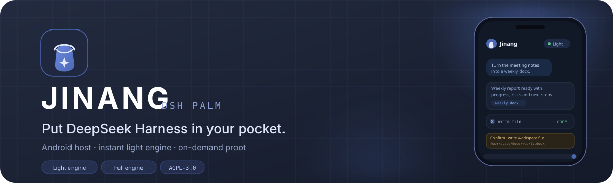
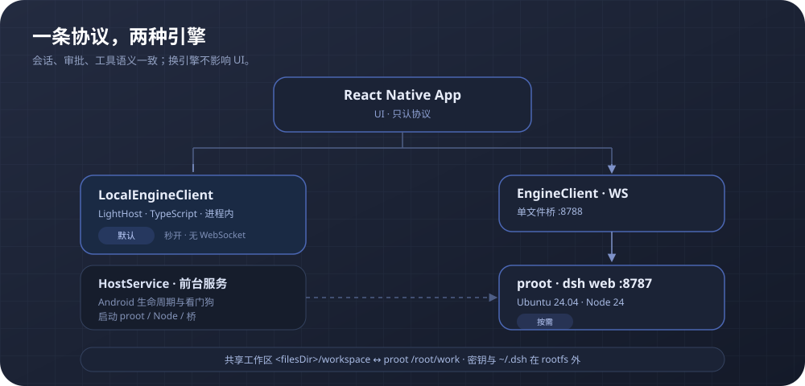

<p align="center">
  
</p>

<p align="center">
  <a href="https://github.com/equb1/dsh-palm/releases/latest"></a>
  
  <a href="LICENSE"></a>
  <a href="https://github.com/equb1/dsh-palm/stargazers"></a>
  <a href="https://equb1.github.io/dsh-palm/"></a>
</p>

<h3 align="center">Put DeepSeek Harness in your pocket</h3>

<p align="center">
  Jinang (dsh-palm) is a DeepSeek Harness host that runs on Android. It starts with an in-process<br>
  TypeScript engine, then brings up a full proot engine only when you need real Linux, Python or long-running jobs.<br>
  A desktop is optional, not required.
</p>

<p align="center">
  <a href="https://github.com/equb1/dsh-palm/releases/latest"></a>
  <a href="https://github.com/equb1/dsh-palm"></a>
  <a href="https://equb1.github.io/dsh-palm/"></a>
</p>

<p align="center"><sub>Unofficial project, not affiliated with DeepSeek. <a href="README.md">中文说明</a></sub></p>

---

## Why Jinang

- **The phone is the host.** It is not a remote control: the light engine, full engine, workspace, notifications and files all run on the phone.
- **Fast by default, real when needed.** The light engine handles everyday chat, documents and tools; proot appears only when real Linux is required.
- **One protocol, two engines.** Sessions, approvals and tools keep the same semantics; a computer can join as an optional second host.

## Features

### Instant light engine, on-demand full engine

- The default TypeScript engine runs in-process inside the app, with no WebSocket hop. Chat, streaming, thinking, tools, approvals and questions all happen locally.
- Switch to the proot engine from the top bar when you need real Linux, Python, pptx or long-running background work. It is reclaimed when idle.
- Both engines share the same session, approval and tool protocol, plus the same workspace. The drawer merges sessions from both sides and switches engines before opening a cross-engine row.

### Documents and Office

- The light engine creates and reads docx and xlsx directly, with built-in image generation and filename sanitising.
- The full engine ships Python 3.12 with python-docx, openpyxl and python-pptx for editing and pptx.
- PDF parsing/generation, legacy `.doc`/`.ppt`, render and recalc are deferred. Complex documents belong to the full engine or a desktop.

### Streaming, approvals and questions

- Thinking and replies stream in; you can steer or stop a run. Tool calls raise approval cards, and missing information becomes a question card.
- Three permission levels (view only / workspace write / full access); model and preset can be changed per session.
- Long streams use stable blocks and explicit follow. Scrolling up does not get yanked back; returning to the bottom resumes following.

### Files, workspace and read-only terminal

- The file screen can list, rename and delete files under `/workspace`. Both engines share the same physical directory, so files stay continuous across switches.
- The read-only terminal supports `pwd`, `ls`, `cat`, `grep` and similar commands; writes are rejected by the sandbox.
- Workspace, device keys and `~/.dsh` live outside rootfs, so replacing the image does not lose them.

### Connectivity, plugins and system entry points

- Official account OAuth with browser PKCE and a loopback callback; account mode discovers the model catalogue automatically.
- Model channels: 43 provider catalogues plus custom providers in the full engine; the light engine uses one OpenAI-compatible channel.
- LAN: scan or enter a desktop host on the same Wi-Fi, and reconnect to the last host after a drop.
- Plugin compatibility: an offline matrix of 305 packages with L0–L3 runtime labels and reasons. The lab can open the L0 WebView; L3 runs in proot.
- System entry points: Quick Settings tile, home-screen widget and notification deep links to sessions or approvals.

### Dark theme and desktop pets

- Follow the system theme or switch light/dark manually. Chat, approvals, files, terminal and code blocks stay consistent.
- **Xiaoji** (the Crabstack hermit crab) drives a 12-state sprite machine; it reacts to thinking, work and approval waits. The floating desktop pet is experimental.

## Install

Download the latest Android APK from [GitHub Releases](https://github.com/equb1/dsh-palm/releases/latest). The APK bundles its runtime and does not need a computer.

- Currently focused on **Android arm64**, primarily verified on Android 16 hardware.
- The first launch unpacks rootfs / the Python layer in roughly 15–25 seconds; later launches are immediate.
- The light engine needs a model channel or an official account. The app guides you through setup.
- The full engine starts on demand and is reclaimed when idle. Check the session permission before running scripts.

## Build from source

Requires **Node 22.13+**; Android builds also need JDK 21 and the Android SDK.

```bash
npm install
npm --prefix app install
npm run verify

bash scripts/setup-android.sh
cd app/android && sh gradlew :app:assembleDebug
```

> `gradlew` does not have the executable bit here; use `sh gradlew`. Images and `.so` files are not committed.

To preview the UI in a browser with the mock engine:

```bash
npm run engine
npm --prefix app run web
```

For a phone preview: `npm --prefix app start`, scan with Expo Go, and use the LAN address printed by `npm run engine` (same Wi-Fi).

## Architecture

<p align="center">
  
</p>

```text
RN App (UI, protocol only)
 ├─ LocalEngineClient (in-process) ── LightHost (TS engine)
 ├─ EngineClient (WS) ── single-file bridge :8788 ── proot dsh web :8787
 ├─ Native host: HostService (foreground service) → proot / Node / bridge
 └─ Native capabilities: share / notifications / camera / SecureStore (light side)
```

- Both engines implement the same `sessions.*`, `approvals.*`, `questions.answer` and tool protocols.
- The workspace is shared at `<filesDir>/workspace`; proot binds it to `/root/work`.
- proot cold start is about 14 seconds and is reclaimed when idle; the light engine targets under 300 ms to ready.
- Routing defaults to the light engine; code, background jobs, pptx and Office editing move to proot on demand.

## Documentation

The canonical docs are Chinese-first. The links below point to the source files, with English summaries.

| Document | What it covers |
|---|---|
| [docs/REQUIREMENTS.md](docs/REQUIREMENTS.md) | Requirements: positioning, v1 goals/non-goals, capability matrix, plugin layers, milestones, acceptance |
| [docs/TECHNICAL.md](docs/TECHNICAL.md) | Technical reference: architecture, protocol, light engine, proot, routing, login/pairing, UI, build |
| [docs/PITFALLS.md](docs/PITFALLS.md) | Pitfalls: symptom → cause → fix → verification |
| [docs/AI-TASKS.md](docs/AI-TASKS.md) | Task board: status, engineering debt, branch/commit rules, commands |
| [docs/RELEASE.md](docs/RELEASE.md) | Release: signing, first install, upgrade and rollback |
| [docs/STREAMING-FIX.md](docs/STREAMING-FIX.md) | Streaming deep dive: root cause, changes and verification |
| [docs/ANIMATION.md](docs/ANIMATION.md) | Motion: page stack, drawer, bottom sheets and performance notes |
| [docs/BRAND-UI.md](docs/BRAND-UI.md) | Brand UI: icon system, home header and interaction details |

Older documents live in [docs/archive/](docs/archive/) and are read-only.

## Repository layout

```text
app/                    RN + Expo; App.tsx entry
  src/lib/              Engine clients, host / notify / share / platform wrappers
  src/protocol/         Protocol contracts
  src/state/store.ts    Hand-written store
  src/ui/               Home / chat / drawer / settings / composer
  src/engine/           Light engine: light / fs / shell / docs
  android/              Expo prebuild + host/*.kt
engine/                 Mock engine + real dsh bridge (real/)
test/                   e2e / approval card / unit tests
scripts/                Probes, bridge build, Android prep, device scripts
runtime/                rootfs layers and profiles
site/                   GitHub Pages landing page
docs/                   Requirements, technical, tasks, release and deep dives
```

## Risks and limitations

- **Android first.** The current target is Android arm64; iOS is not supported yet.
- **The full engine has a cost.** proot cold start is about 14 seconds and memory use is significant. Without bwrap / Landlock, running scripts may require full access.
- **LAN is not end-to-end encrypted yet.** Discovery and reconnects work; relay / WebRTC remain on the roadmap.
- **Document limits.** PDF is deferred; legacy Office formats, render and recalc depend on a desktop or future work.
- **Plugins are not all runnable.** The compatibility matrix explains the runtime; L1 is unfinished, L2 has no standalone runtime, and L4 depends on a computer.
- **OAuth tokens have no refresh.** Re-login when the official account token expires.

## Conventions

- **Branches:** cut from `develop`, one branch per task, merge through an MR. Do not push directly to `develop`. See [docs/AI-TASKS.md](docs/AI-TASKS.md).
- **Docs:** task status only in AI-TASKS; implementation only in TECHNICAL; new pitfalls in PITFALLS; requirements only in REQUIREMENTS. Do not hard-code test counts.
- **Dependencies:** use **npm** for the workspace and `app/`. Do not mix pnpm; it breaks autolinking.

## License

[AGPL-3.0](LICENSE). Jinang is an unofficial project and is not affiliated with DeepSeek. DeepSeek Harness and related names belong to their respective owners.
