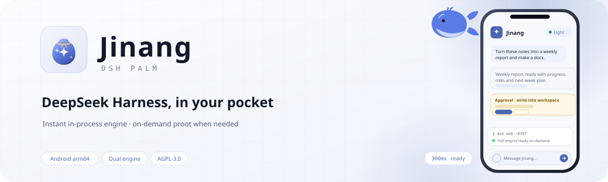
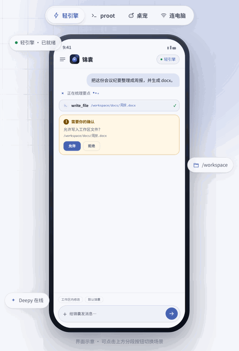
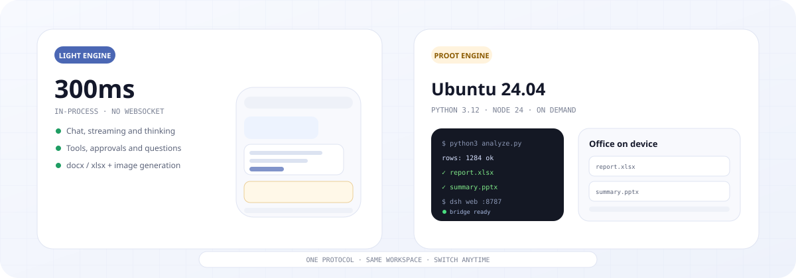
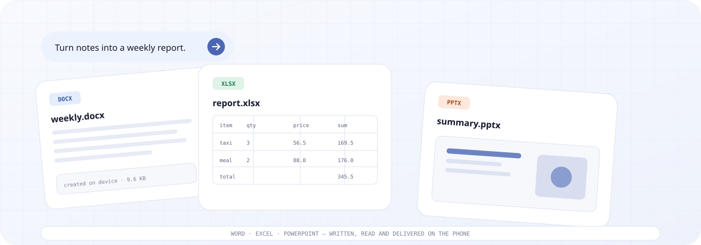
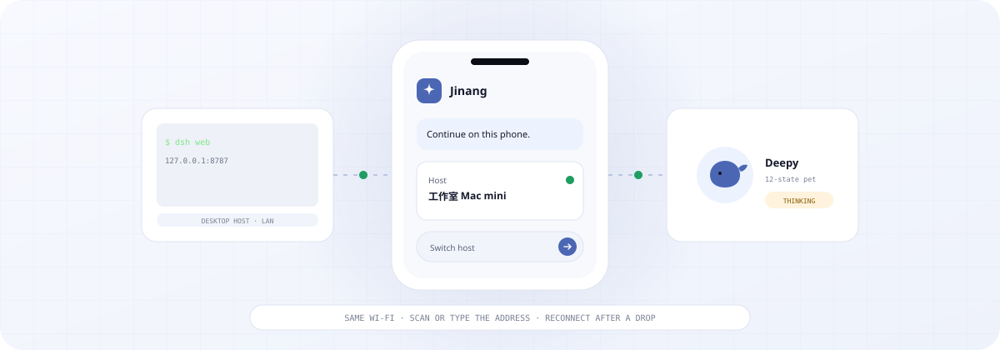

<p align="center">
  <a href="README.md">简体中文</a> · <b>English</b>
</p>

<p align="center">
  <picture>
    <source media="(prefers-color-scheme: dark)" srcset="site/assets/hero-en-dark.svg">
    
  </picture>
</p>

<p align="center">
  A DeepSeek Harness host that runs on Android. The in-process light engine answers instantly;<br>
  a full proot engine comes up only when you need real Linux, Python or long-running jobs. A computer is optional.
</p>

<p align="center">
  <a href="https://github.com/equb1/dsh-palm/releases/latest"></a>
  
  <a href="LICENSE"></a>
  <a href="https://equb1.github.io/dsh-palm/"></a>
  <a href="https://github.com/equb1/dsh-palm/stargazers"></a>
</p>

<p align="center">
  <a href="https://github.com/equb1/dsh-palm/releases/latest"></a>&emsp;
  <a href="https://equb1.github.io/dsh-palm/"></a>
</p>

<p align="center">
  <b>If Jinang saves you a trip to the computer, leave a ⭐ Star and help the next release arrive sooner.</b>
</p>

<p align="center">
  <a href="https://github.com/equb1/dsh-palm/stargazers"></a>
</p>

<p align="center">
  <sub>Install the APK to get started; the full engine starts on demand, so everyday chat never waits for proot.<br>
  An early test build signed with a different key cannot be updated in place: uninstall it first.</sub>
</p>

<br>

<a id="demo"></a>
<h3 align="center">Six seconds, end to end</h3>

<p align="center">
  
</p>

<p align="center"><sub>Light engine writes a report → approval → proot runs Python → the pet keeps working</sub></p>

<br>

<h3 align="center">Deepy and Whale girl keep you company</h3>

<p align="center">They code, flip, wave and nap along with DSH, and can follow you to the home screen.</p>

<p align="center">
  
  
  
  
</p>

<p align="center">
  
  
  
  
</p>

<br>

<a id="download"></a>
<h3 align="center">Download Jinang</h3>

<p align="center">Get the latest APK from GitHub Releases. It bundles its runtime and does not need a computer.</p>

<p align="center">
  <a href="https://github.com/equb1/dsh-palm/releases/latest"></a>&emsp;
  <a href="https://equb1.github.io/dsh-palm/"></a>
</p>

<p align="center">
  <sub>Currently focused on <b>Android arm64</b>, primarily verified on Android 16 hardware. The first launch unpacks rootfs / Python in roughly 15–25 seconds; later launches are immediate.</sub>
</p>

<br>

<h3 align="center">Instant light engine, on-demand full engine</h3>

<p align="center">The default TypeScript engine runs in-process with no WebSocket hop. Switch to proot when you need real Linux, Python, pptx or Office editing. Both engines share one session / approval / tool protocol and the same workspace.</p>

<p align="center">
  <picture>
    <source media="(prefers-color-scheme: dark)" srcset="site/assets/showcase-engines-dark.svg">
    
  </picture>
</p>

<br>

<h3 align="center">docx / xlsx / pptx, delivered on the phone</h3>

<p align="center">The light engine writes and reads Word and Excel directly. The full engine adds Python 3.12 with python-docx, openpyxl and python-pptx for scripts and slide decks without a desktop.</p>

<p align="center">
  <picture>
    <source media="(prefers-color-scheme: dark)" srcset="site/assets/showcase-office-dark.svg">
    
  </picture>
</p>

<br>

<h3 align="center">Runs on your phone. Drives your computer.</h3>

<p align="center">Discover a computer host on the same Wi-Fi and reconnect after a drop. The phone is a full host; a computer is an optional second one.</p>

<p align="center">
  <picture>
    <source media="(prefers-color-scheme: dark)" srcset="site/assets/showcase-hosts-dark.svg">
    
  </picture>
</p>

<br>

## Features

Jinang combines a chat interface, an on-device runtime and remote connections in one Android app. It is a third-party project built on [DeepSeek Harness](https://github.com/deepseek-ai/deepseek-harness). The DSH engine runs on your phone; model requests are still handled by the model provider you configure.

- **On-device host:** the light engine runs in-process for chat, streaming, thinking, tools, approvals and questions. The proot engine starts only when real Linux is needed and is reclaimed when idle.
- **Documents and Office:** docx / xlsx in the light engine; pptx, Python 3.12 and Office editing in the full engine.
- **Streaming, approvals and questions:** tool calls ask first, missing information becomes a question card, and long streams support steering, stopping and manual follow.
- **Files and terminal:** browse, rename and delete `/workspace`; the read-only terminal can inspect the environment while writes are rejected by the sandbox.
- **Connectivity and plugins:** official account OAuth, 43 provider catalogues plus custom providers, LAN discovery and reconnects, and an offline compatibility matrix of 305 packages.
- **System entry points and pets:** Quick Settings tile, home-screen widget, notification deep links, and deepy / Whale girl with a 12-state machine.

## Install

1. Download the latest Android APK from [GitHub Releases](https://github.com/equb1/dsh-palm/releases/latest) (most phones need arm64).
2. On first launch, follow the prompt to configure a model channel or sign in to an official account.
3. Keep everyday chat on the light engine; switch to the full engine from the top bar when you need Python, pptx or background jobs.

- Requires **Android arm64**; iOS is not supported yet.
- The first launch unpacks rootfs / Python in roughly 15–25 seconds; later launches are immediate.
- The full engine starts on demand and is reclaimed when idle. Check the session permission before running scripts.
- An early test build signed with a different key cannot be updated in place; uninstalling clears chats, the runtime and settings.

## Architecture

<p align="center">
  
</p>

```text
RN App (UI, protocol only)
 ├─ LocalEngineClient (in-process) ── LightHost (TS engine)
 ├─ EngineClient (WS) ── single-file bridge :8788 ── proot dsh web :8787
 ├─ Native host: HostService (foreground service) → proot / Node / bridge
 └─ Native capabilities: share / notifications / camera / SecureStore (light side)
```

- Both engines implement the same `sessions.*`, `approvals.*`, `questions.answer` and tool protocols.
- The workspace is shared at `<filesDir>/workspace`; proot binds it to `/root/work`.
- proot cold start is about 14 seconds and is reclaimed when idle; the light engine targets under 300 ms to ready.
- Routing defaults to the light engine; code, background jobs, pptx and Office editing move to proot on demand.

## Documentation

The canonical docs are Chinese-first. The links below point to the source files, with English summaries.

| Document | What it covers |
|---|---|
| [docs/REQUIREMENTS.md](docs/REQUIREMENTS.md) | Requirements: positioning, v1 goals/non-goals, capability matrix, plugin layers, milestones, acceptance |
| [docs/TECHNICAL.md](docs/TECHNICAL.md) | Technical reference: architecture, protocol, light engine, proot, routing, login/pairing, UI, build |
| [docs/PITFALLS.md](docs/PITFALLS.md) | Pitfalls: symptom → cause → fix → verification |
| [docs/AI-TASKS.md](docs/AI-TASKS.md) | Task board: status, engineering debt, branch/commit rules, commands |
| [docs/RELEASE.md](docs/RELEASE.md) | Release: signing, first install, upgrade and rollback |
| [docs/STREAMING-FIX.md](docs/STREAMING-FIX.md) | Streaming deep dive: root cause, changes and verification |
| [docs/ANIMATION.md](docs/ANIMATION.md) | Motion: page stack, drawer, bottom sheets and performance notes |
| [docs/BRAND-UI.md](docs/BRAND-UI.md) | Brand UI: icon system, home header and interaction details |

Older documents live in [docs/archive/](docs/archive/) and are read-only.

## Repository layout

```text
app/                    RN + Expo; App.tsx entry
  src/lib/              Engine clients, host / notify / share / platform wrappers
  src/protocol/         Protocol contracts
  src/state/store.ts    Hand-written store
  src/ui/               Home / chat / drawer / settings / composer
  src/engine/           Light engine: light / fs / shell / docs
  android/              Expo prebuild + host/*.kt
engine/                 Mock engine + real dsh bridge (real/)
test/                   e2e / approval card / unit tests
scripts/                Probes, bridge build, Android prep, device scripts
runtime/                rootfs layers and profiles
site/                   GitHub Pages landing page
docs/                   Requirements, technical, tasks, release and deep dives
```

## Build from source

Requires **Node 22.13+**; Android builds also need JDK 21 and the Android SDK.

```bash
npm install
npm --prefix app install
npm run verify

bash scripts/setup-android.sh
cd app/android && sh gradlew :app:assembleDebug
```

> `gradlew` does not have the executable bit here; use `sh gradlew`. Images and `.so` files are not committed.

To preview the UI in a browser with the mock engine:

```bash
npm run engine
npm --prefix app run web
```

For a phone preview: `npm --prefix app start`, scan with Expo Go, and use the LAN address printed by `npm run engine` (same Wi-Fi).

## Risks and limitations

- **Android first.** The current target is Android arm64; iOS is not supported yet.
- **The full engine has a cost.** proot cold start is about 14 seconds and memory use is significant. Without bwrap / Landlock, running scripts may require full access.
- **LAN is not end-to-end encrypted yet.** Discovery and reconnects work; relay / WebRTC remain on the roadmap.
- **Document limits.** PDF is deferred; legacy Office formats, render and recalc depend on a desktop or future work.
- **Plugins are not all runnable.** The compatibility matrix explains the runtime; L1 is unfinished, L2 has no standalone runtime, and L4 depends on a computer.
- **OAuth tokens have no refresh.** Re-login when the official account token expires.

## FAQ

<details>
<summary><b>Is this an official DeepSeek app?</b></summary>
<br>

No. Jinang is an unofficial Android host made by the community, built on the open-source [DeepSeek Harness](https://github.com/deepseek-ai/deepseek-harness). DSH itself runs on your phone; model requests go to the provider you configure, so it needs a connection and bills your account with that provider.

</details>

<details>
<summary><b>Light engine or full engine?</b></summary>
<br>

Stay on the light engine by default: an in-process TypeScript engine that targets under 300 ms to ready, covering chat, streaming, tools, docx / xlsx and image generation. Switch to the proot engine for real Linux, Python packages, pptx or long-running background jobs; it takes about 14 seconds to start and is reclaimed when idle.

</details>

<details>
<summary><b>Will the system kill it in the background?</b></summary>
<br>

The full engine runs behind an Android foreground service. Some battery savers still hold apps back; when that happens, follow the keep-alive page in the app to allow the relevant settings.

</details>

<details>
<summary><b>What phone do I need?</b></summary>
<br>

The current build targets Android arm64 and is primarily verified on Android 16 hardware. The first launch unpacks rootfs / Python, so leave enough free space and wait 15–25 seconds. The light engine does not need root or Termux.

</details>

<details>
<summary><b>Why the name Jinang?</b></summary>
<br>

A jinang is a small silk pouch used to keep important things close at hand. We want AI to feel the same way: light, instant, and ready to produce a full Linux environment when a heavier job appears. The technical name `dsh-palm` means DSH in the palm of your hand.

</details>

<details>
<summary><b>Is it open source? Can I modify it?</b></summary>
<br>

Yes. The code is in this repository under [AGPL-3.0](LICENSE). Forking to study, self-host and build on is welcome; when you redistribute, keep the license and copyright notices and credit the upstream repository and author.

</details>

## Contributing

Report bugs and suggest improvements in [Issues](https://github.com/equb1/dsh-palm/issues). For code, documentation and translation changes, start with the branch, commit and verification conventions in [docs/AI-TASKS.md](docs/AI-TASKS.md).

- **Branches:** cut from `develop`, one branch per task, merge through an MR. Do not push directly to `develop`.
- **Docs:** task status only in AI-TASKS; implementation only in TECHNICAL; new pitfalls in PITFALLS; requirements only in REQUIREMENTS. Do not hard-code test counts.
- **Dependencies:** use **npm** for the workspace and `app/`. Do not mix pnpm; it breaks autolinking.

## Acknowledgements

- [DeepSeek Harness](https://github.com/deepseek-ai/deepseek-harness): what Jinang runs and connects to.
- [dsh-go](https://github.com/ccch1mneyyy/dsh-go): the pet specification, composer geometry and some interaction details reference its public design; Jinang's code and assets are independently implemented.
- Everyone who filed issues, verified on real devices or contributed to the plugin compatibility matrix.

## License

[AGPL-3.0](LICENSE). Jinang is an unofficial project and is not affiliated with DeepSeek. DeepSeek Harness and related names belong to their respective owners.

<br>

<p align="center"><sub>Jinang · dsh-palm — DeepSeek Harness, in your pocket.</sub></p>
