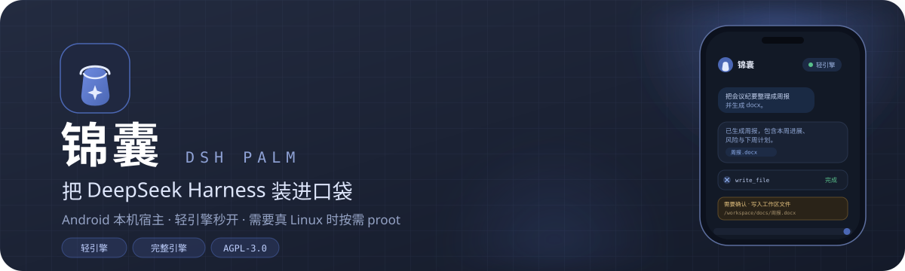
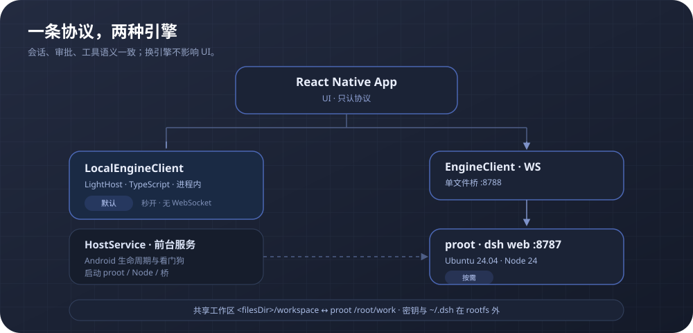

<p align="center">
  
</p>

<p align="center">
  <a href="https://github.com/equb1/dsh-palm/releases/latest"></a>
  
  <a href="LICENSE"></a>
  <a href="https://github.com/equb1/dsh-palm/stargazers"></a>
  <a href="https://equb1.github.io/dsh-palm/"></a>
</p>

<h3 align="center">把 DeepSeek Harness 装进口袋</h3>

<p align="center">
  锦囊（dsh-palm）是运行在 Android 手机上的 DSH 宿主：默认在本机跑轻量 TypeScript 引擎，打开即用；<br>
  需要真 Linux、Python 或后台长任务时，再按需拉起 proot 完整引擎。电脑是可选的另一台宿主。
</p>

<p align="center">
  <a href="https://github.com/equb1/dsh-palm/releases/latest"></a>
  <a href="https://github.com/equb1/dsh-palm"></a>
  <a href="https://equb1.github.io/dsh-palm/"></a>
</p>

<p align="center"><sub>非官方项目，与 DeepSeek 无隶属关系。英文说明见 <a href="README.en.md">README.en.md</a>。</sub></p>

---

## 为什么是锦囊

- **手机是完整宿主。** 不是遥控器：轻引擎、完整引擎、工作区、通知和文件都在手机上跑。
- **默认快，按需真。** 轻引擎负责随身问答、文档和日常工具；proot 只在需要真 Linux 时出现。
- **一条协议，两种引擎。** 会话、审批、工具语义一致；电脑也可以作为另一台宿主接进来。

## 功能

### 轻引擎秒开，完整引擎按需

- 默认轻量 TS 引擎在 App 进程内运行，不经过 WebSocket；对话、流式、思考、工具、审批、提问都在手机本地完成。
- 需要真 Linux、Python、pptx 或后台长任务时，从顶栏切到 proot 完整引擎；空闲会自动回收。
- 两种引擎共用同一套会话 / 审批 / 工具协议和同一个工作区；抽屉统一展示两侧会话，跨引擎行先切引擎再打开。

### 文档与 Office

- 轻引擎可直接创建、读取 docx 与 xlsx，内置图像生成和文件名清洗。
- 完整引擎自带 Python 3.12 与 python-docx、openpyxl、python-pptx，可做编辑与 pptx。
- PDF 解析 / 生成、旧 `.doc` / `.ppt`、render / recalc 暂缓；复杂文档走完整引擎或桌面端。

### 流式、审批与提问

- 思考与正文流式输出，支持插话、停止；工具调用先出审批卡，信息不足时用提问卡澄清。
- 权限三档（仅可查看 / 工作区内修改 / 完全权限）；模型与锦囊预设可按会话切换。
- 长会话流式有稳定块与手动跟随：用户上滑后不会被自动追底抢走，回到底部可恢复。

### 文件、工作区与只读终端

- 文件页可浏览、重命名、删除 `/workspace`；轻 / 完整引擎共用同一物理目录，切换后文件连续。
- 只读终端支持 `pwd` / `ls` / `cat` / `grep` 等查看命令，写操作会被沙箱拒绝。
- 工作区、设备密钥与 `~/.dsh` 都在 rootfs 外，换镜像不丢。

### 连接、插件与系统入口

- 官方账号 OAuth：浏览器 PKCE + loopback 回调；账号模式会自动拉取模型目录。
- 模型渠道：完整引擎支持 43 个提供商目录 + 自定义渠道；轻引擎使用一条 OpenAI 兼容渠道。
- LAN：同一 Wi-Fi 下扫描或手填电脑宿主地址，断线后可重连上次宿主。
- 插件兼容矩阵：内置 305 个包的离线快照，按 L0–L3 标注运行方式与判定理由；实验室可打开 L0 WebView，L3 走 proot。
- 系统入口：QS 磁贴、桌面小组件、通知直达会话 / 审批；常驻通知也能回到 App。

### 深色主题与桌宠

- 主题跟随系统，也可手动切换浅色 / 深色；聊天、审批、文件、终端和代码块一致。
- 内置 deepy / maid 逐帧桌宠素材与 12 态状态机，随思考、工作、审批等待切换动作；桌面悬浮窗为实验能力。

## 安装

从 [GitHub Releases](https://github.com/equb1/dsh-palm/releases/latest) 下载最新 Android APK。APK 自带运行时，不需要电脑。

- 当前聚焦 **Android arm64**，主要在 Android 16 真机验证。
- 首次启动会解压 rootfs / Python 层，约 15–25 秒；之后打开即用。
- 轻引擎需要模型渠道或官方账号；没配置时 App 会引导设置。
- 完整引擎按需启动，空闲回收；跑脚本前先确认会话权限。

## 源码构建

需要 **Node 22.13+**；打 Android 包还需要 JDK 21 与 Android SDK。

```bash
npm install
npm --prefix app install
npm run verify

bash scripts/setup-android.sh
cd app/android && sh gradlew :app:assembleDebug
```

> `gradlew` 没有可执行位，用 `sh gradlew`。镜像与 `.so` 不进 git。

只想看界面时，用 mock 引擎在浏览器里跑：

```bash
npm run engine
npm --prefix app run web
```

手机预览：`npm --prefix app start`，用 Expo Go 扫码，引擎地址填 `npm run engine` 打印的 LAN 地址（同一 Wi-Fi）。

## 架构

<p align="center">
  
</p>

```text
RN App（UI，只认协议）
 ├─ LocalEngineClient（进程内）── LightHost（TS 引擎）
 ├─ EngineClient（WS）── 单文件桥 :8788 ── proot 里的 dsh web :8787
 ├─ 原生宿主：HostService（前台服务）→ proot / Node / 桥
 └─ 原生能力：分享 / 通知 / 相机 / SecureStore（轻引擎侧）
```

- 两种引擎实现同一套 `sessions.*`、`approvals.*`、`questions.answer` 等协议。
- 工作区共用 `<filesDir>/workspace`；proot 里 bind 为 `/root/work`。
- proot 冷启动约 14 秒，空闲回收；轻引擎目标 300ms 内就绪。
- 路由默认轻引擎；代码、后台任务、pptx、Office 编辑等按需切 proot。

## 文档

| 文档 | 内容 |
|---|---|
| [docs/REQUIREMENTS.md](docs/REQUIREMENTS.md) | **需求**：定位、v1 目标 / 非目标、能力矩阵、插件分层、里程碑与验收 |
| [docs/TECHNICAL.md](docs/TECHNICAL.md) | **技术**：架构、协议、轻引擎、proot、路由、登录配对、UI、构建 |
| [docs/PITFALLS.md](docs/PITFALLS.md) | **踩坑**：现象 → 原因 → 处理 → 验证 |
| [docs/AI-TASKS.md](docs/AI-TASKS.md) | **任务**：任务状态、工程债、分支 / 提交规则、常用命令 |
| [docs/BRAND-PET.md](docs/BRAND-PET.md) | **品牌与桌宠**：Crabstack/蟹栈、图标资产、小寄状态机、提示词、验收 |
| [docs/RELEASE.md](docs/RELEASE.md) | **发布**：签名、首装、覆盖升级与回滚 |
| [docs/STREAMING-FIX.md](docs/STREAMING-FIX.md) | **专项**：长会话流式的根因、改动与验证 |
| [docs/ANIMATION.md](docs/ANIMATION.md) | **动效**：页面栈、抽屉、底部弹层与性能实测 |
| [docs/BRAND-UI.md](docs/BRAND-UI.md) | **品牌**：图标系统、首页顶栏、打字机与交互细节 |

旧文档在 [docs/archive/](docs/archive/)（只读）。

## 目录

```text
app/                    RN + Expo；App.tsx 入口
  src/lib/              引擎客户端、host / notify / share / platform 封装
  src/protocol/         协议契约
  src/state/store.ts    手写 store
  src/ui/               首页 / 聊天 / 抽屉 / 设置 / 输入区
  src/engine/           轻引擎：light / fs / shell / docs
  android/              Expo prebuild + host/*.kt
engine/                 mock 引擎 + 真 dsh 桥（real/）
test/                   e2e / 审批卡 / 单元
scripts/                探针、建桥、构建准备、真机脚本
runtime/                rootfs 分层与 profile
site/                   GitHub Pages 落地页
docs/                   需求、技术、任务、发布与专项文档
```

## 风险与限制

- **Android 优先**：当前聚焦 Android arm64，iOS 尚未支持。
- **完整引擎有成本**：proot 冷启动约 14 秒、常驻内存较高；无 bwrap / Landlock 时，跑脚本可能需要「完全权限」。
- **局域网尚未端到端加密**：LAN 发现与重连已可用；relay / WebRTC 仍在路线图。
- **文档边界**：PDF 暂缓；旧 Office 格式、render / recalc 依赖桌面端或后续能力。
- **插件不是全量可跑**：兼容矩阵给出运行方式；L1 未完成、L2 无独立运行时、L4 依赖电脑。
- **登录 token 无 refresh**：官方账号 token 过期后需要重新登录。

## 约定

- **分支**：从 `develop` 切，一个方面的任务一个分支，走 MR 合并；不直推 `develop`。见 [docs/AI-TASKS.md](docs/AI-TASKS.md)。
- **文档**：任务状态只改 AI-TASKS；技术只改 TECHNICAL；新坑进 PITFALLS；需求只改 REQUIREMENTS。不要写死测试条数。
- **依赖**：统一用 **npm**，不要混 pnpm（会破坏 autolinking）。

## 许可

[AGPL-3.0](LICENSE)。锦囊是非官方项目，与 DeepSeek 无隶属关系；DeepSeek Harness 及相关名称归其权利人所有。
