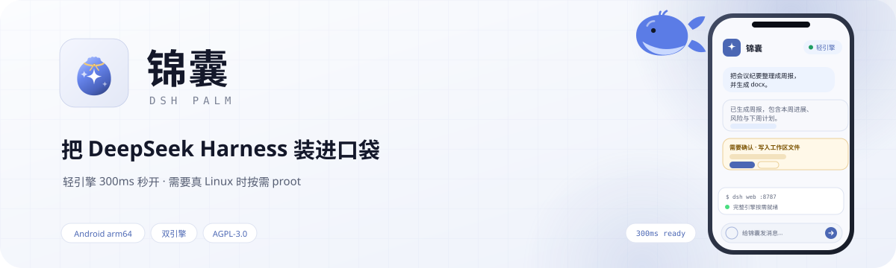
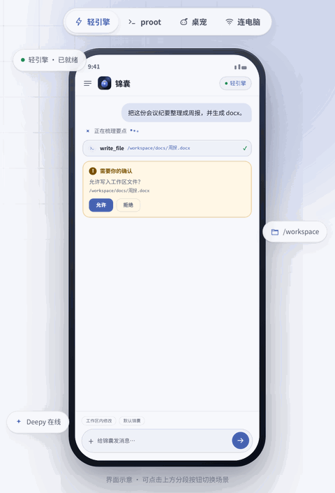
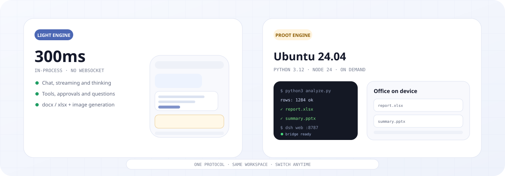
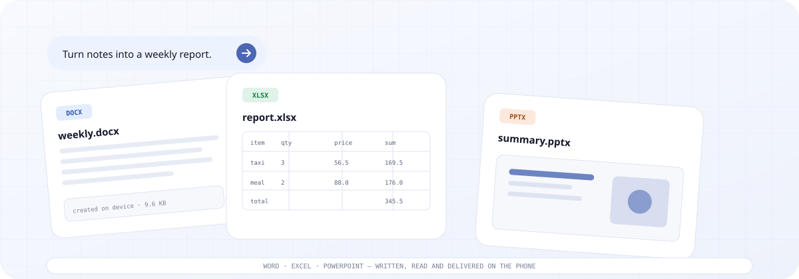
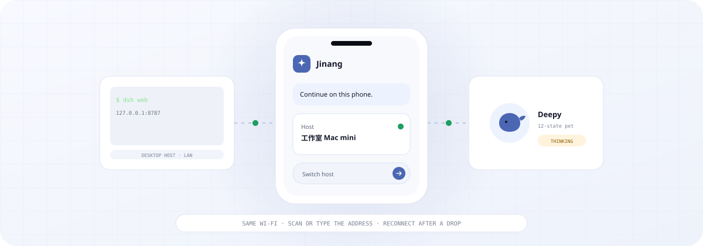

<p align="center">
  <b>简体中文</b> · <a href="README.en.md">English</a>
</p>

<p align="center">
  <picture>
    <source media="(prefers-color-scheme: dark)" srcset="site/assets/hero-zh-dark.svg">
    
  </picture>
</p>

<p align="center">
  运行在 Android 手机上的 DeepSeek Harness 宿主。进程内轻引擎打开即答，<br>
  需要真 Linux、Python 或后台长任务时，再按需拉起 proot 完整引擎。电脑是可选的第二台宿主。
</p>

<p align="center">
  <a href="https://github.com/equb1/dsh-palm/releases/latest"></a>
  
  <a href="LICENSE"></a>
  <a href="https://equb1.github.io/dsh-palm/"></a>
  <a href="https://github.com/equb1/dsh-palm/stargazers"></a>
</p>

<p align="center">
  <a href="https://github.com/equb1/dsh-palm/releases/latest"></a>&emsp;
  <a href="https://equb1.github.io/dsh-palm/"></a>
</p>

<p align="center">
  <b>如果锦囊帮你省下了开电脑的那一步，顺手点亮一颗 ⭐ Star，让下一个版本来得更快一点。</b>
</p>

<p align="center">
  <a href="https://github.com/equb1/dsh-palm/stargazers"></a>
</p>

<p align="center">
  <sub>第一次用可以直接装 APK；完整引擎按需启动，日常问答不会等 proot。<br>
  手机上装过签名不同的早期测试包时不能直接覆盖安装，需要先卸载旧版。</sub>
</p>

<br>

<a id="demo"></a>
<h3 align="center">六秒看懂</h3>

<p align="center">
  
</p>

<p align="center"><sub>轻引擎生成周报 → 审批写入 → 切到 proot 跑 Python → 桌宠陪跑</sub></p>

<br>

<h3 align="center">Deepy 和鲸娘，陪你干活</h3>

<p align="center">干活时敲代码，做完来个空翻，等你确认会举手。打开「App 外显示」，它们还会跟你到桌面。</p>

<p align="center">
  
  
  
  
</p>

<p align="center">
  
  
  
  
</p>

<br>

<a id="download"></a>
<h3 align="center">下载锦囊</h3>

<p align="center">从 GitHub Releases 下载最新 APK。APK 自带运行时，不需要电脑在旁边。</p>

<p align="center">
  <a href="https://github.com/equb1/dsh-palm/releases/latest"></a>&emsp;
  <a href="https://equb1.github.io/dsh-palm/"></a>
</p>

<p align="center">
  <sub>当前聚焦 <b>Android arm64</b>，主要在 Android 16 真机验证。首次启动会解压 rootfs / Python 层，约 15–25 秒；之后打开即用。</sub>
</p>

<br>

<h3 align="center">轻引擎秒开，完整引擎按需</h3>

<p align="center">默认 TypeScript 引擎在 App 进程内运行，不经过 WebSocket；代码、后台任务、pptx 与 Office 编辑需要真环境时，再切到 proot。两种引擎共用一套会话、审批和工具协议，以及同一个工作区。</p>

<p align="center">
  <picture>
    <source media="(prefers-color-scheme: dark)" srcset="site/assets/showcase-engines-dark.svg">
    
  </picture>
</p>

<br>

<h3 align="center">docx / xlsx / pptx，手机上交付</h3>

<p align="center">轻引擎直接创建和读取 Word、Excel；完整引擎自带 Python 3.12 与 python-docx、openpyxl、python-pptx，跑脚本、做汇报页都不用开电脑。</p>

<p align="center">
  <picture>
    <source media="(prefers-color-scheme: dark)" srcset="site/assets/showcase-office-dark.svg">
    
  </picture>
</p>

<br>

<h3 align="center">本机能跑，也能连家里的电脑</h3>

<p align="center">同一 Wi-Fi 下自动发现电脑宿主，断线后重连上次地址。手机是完整宿主，电脑是可选的第二台。</p>

<p align="center">
  <picture>
    <source media="(prefers-color-scheme: dark)" srcset="site/assets/showcase-hosts-dark.svg">
    
  </picture>
</p>

<br>

## 可以做什么

锦囊把聊天界面、本机运行环境和远程连接放进同一个 Android App，基于 [DeepSeek Harness](https://github.com/deepseek-ai/deepseek-harness) 构建。运行在手机上的是 DSH 引擎；模型请求仍由你配置的模型提供方处理。

- **本机宿主**：轻引擎在进程内跑，对话、流式、思考、工具、审批、提问都在手机上完成；需要真 Linux 时按需拉起 proot，空闲自动回收。
- **文档与 Office**：轻引擎直接写 docx / xlsx，完整引擎补上 pptx、Python 3.12 和 Office 编辑。
- **流式、审批与提问**：工具调用先确认，信息不足时用提问卡澄清；支持插话、停止、长会话手动跟随。
- **文件与终端**：浏览、重命名、删除 `/workspace`；只读终端可查看环境，写操作被沙箱拒绝。
- **连接与插件**：官方账号 OAuth、43 个提供商目录 + 自定义渠道、LAN 发现与重连、305 个包的兼容矩阵。
- **系统入口与桌宠**：QS 磁贴、桌面小组件、通知直达会话 / 审批；deepy / 鲸娘 12 态桌宠随任务切换动作。

## 安装

1. 从 [GitHub Releases](https://github.com/equb1/dsh-palm/releases/latest) 下载最新 Android APK（常见手机选 arm64）。
2. 首次启动按引导选择模型渠道或登录官方账号；没配置时 App 会给出入口。
3. 日常问答留在轻引擎；需要 Python、pptx 或后台任务时，从顶栏切到完整引擎。

- 需要 **Android arm64**；iOS 尚未支持。
- 首次启动解压 rootfs / Python 层约 15–25 秒；之后打开即用。
- 完整引擎按需启动，空闲回收；跑脚本前先确认会话权限。
- 签名不同的旧测试包不能直接覆盖安装；卸载会清空会话、运行环境和设置。

## 架构

<p align="center">
  
</p>

```text
RN App（UI，只认协议）
 ├─ LocalEngineClient（进程内）── LightHost（TS 引擎）
 ├─ EngineClient（WS）── 单文件桥 :8788 ── proot 里的 dsh web :8787
 ├─ 原生宿主：HostService（前台服务）→ proot / Node / 桥
 └─ 原生能力：分享 / 通知 / 相机 / SecureStore（轻引擎侧）
```

- 两种引擎实现同一套 `sessions.*`、`approvals.*`、`questions.answer` 等协议。
- 工作区共用 `<filesDir>/workspace`；proot 里 bind 为 `/root/work`。
- proot 冷启动约 14 秒，空闲回收；轻引擎目标 300ms 内就绪。
- 路由默认轻引擎；代码、后台任务、pptx、Office 编辑等按需切 proot。

## 文档

| 文档 | 内容 |
|---|---|
| [docs/REQUIREMENTS.md](docs/REQUIREMENTS.md) | **需求**：定位、v1 目标 / 非目标、能力矩阵、插件分层、里程碑与验收 |
| [docs/TECHNICAL.md](docs/TECHNICAL.md) | **技术**：架构、协议、轻引擎、proot、路由、登录配对、UI、构建 |
| [docs/PITFALLS.md](docs/PITFALLS.md) | **踩坑**：现象 → 原因 → 处理 → 验证 |
| [docs/AI-TASKS.md](docs/AI-TASKS.md) | **任务**：任务状态、工程债、分支 / 提交规则、常用命令 |
| [docs/RELEASE.md](docs/RELEASE.md) | **发布**：签名、首装、覆盖升级与回滚 |
| [docs/STREAMING-FIX.md](docs/STREAMING-FIX.md) | **专项**：长会话流式的根因、改动与验证 |
| [docs/ANIMATION.md](docs/ANIMATION.md) | **动效**：页面栈、抽屉、底部弹层与性能实测 |
| [docs/BRAND-UI.md](docs/BRAND-UI.md) | **品牌**：图标系统、首页顶栏、打字机与交互细节 |

旧文档在 [docs/archive/](docs/archive/)（只读）。

## 目录

```text
app/                    RN + Expo；App.tsx 入口
  src/lib/              引擎客户端、host / notify / share / platform 封装
  src/protocol/         协议契约
  src/state/store.ts    手写 store
  src/ui/               首页 / 聊天 / 抽屉 / 设置 / 输入区
  src/engine/           轻引擎：light / fs / shell / docs
  android/              Expo prebuild + host/*.kt
engine/                 mock 引擎 + 真 dsh 桥（real/）
test/                   e2e / 审批卡 / 单元
scripts/                探针、建桥、构建准备、真机脚本
runtime/                rootfs 分层与 profile
site/                   GitHub Pages 落地页
docs/                   需求、技术、任务、发布与专项文档
```

## 从源码构建

需要 **Node 22.13+**；打 Android 包还需要 JDK 21 与 Android SDK。

```bash
npm install
npm --prefix app install
npm run verify

bash scripts/setup-android.sh
cd app/android && sh gradlew :app:assembleDebug
```

> `gradlew` 没有可执行位，用 `sh gradlew`。镜像与 `.so` 不进 git。

只想看界面时，用 mock 引擎在浏览器里跑：

```bash
npm run engine
npm --prefix app run web
```

手机预览：`npm --prefix app start`，用 Expo Go 扫码，引擎地址填 `npm run engine` 打印的 LAN 地址（同一 Wi-Fi）。

## 风险与限制

- **Android 优先**：当前聚焦 Android arm64，iOS 尚未支持。
- **完整引擎有成本**：proot 冷启动约 14 秒、常驻内存较高；无 bwrap / Landlock 时，跑脚本可能需要「完全权限」。
- **局域网尚未端到端加密**：LAN 发现与重连已可用；relay / WebRTC 仍在路线图。
- **文档边界**：PDF 解析 / 生成暂缓；旧 `.doc` / `.ppt`、render / recalc 依赖桌面端或后续能力。
- **插件不是全量可跑**：兼容矩阵给出运行方式；L1 未完成、L2 无独立运行时、L4 依赖电脑。
- **登录 token 无 refresh**：官方账号 token 过期后需要重新登录。

## 常见问题

<details>
<summary><b>和 DeepSeek 官方是什么关系？</b></summary>
<br>

没有关系。锦囊是社区开发的非官方 Android 宿主，基于开源的 [DeepSeek Harness](https://github.com/deepseek-ai/deepseek-harness) 构建。手机上运行的是 DSH 本身；模型请求发给你配置的模型提供方，需要联网，并按你在提供方的账户计费。

</details>

<details>
<summary><b>轻引擎和完整引擎怎么选？</b></summary>
<br>

默认留在轻引擎：进程内 TypeScript 引擎，目标 300ms 内就绪，适合问答、流式、工具、docx / xlsx 和生图。需要真 Linux、Python 包、pptx、后台长任务时，切到 proot 完整引擎；它会冷启动约 14 秒，空闲后自动回收。

</details>

<details>
<summary><b>切到后台会被杀吗？</b></summary>
<br>

完整引擎通过 Android 前台服务保活；部分系统的省电策略仍可能拦住后台。遇到通知消失或引擎断开时，按 App 内「保活」页的指引放行对应设置。

</details>

<details>
<summary><b>对手机有什么要求？</b></summary>
<br>

当前构建面向 Android arm64，主要在 Android 16 真机验证。首次启动需要解压 rootfs / Python 层，预留足够空间并耐心等待 15–25 秒。轻引擎不需要 root 或 Termux。

</details>

<details>
<summary><b>为什么叫锦囊？</b></summary>
<br>

古人把重要的东西装进锦囊，需要时再打开。我们希望 AI 也是这样的随身物件：平时轻巧、打开即用，遇到重活再从囊里掏出完整的 Linux。技术名 `dsh-palm` 则对应「把 DSH 放在掌心」。

</details>

<details>
<summary><b>开源吗？可以改吗？</b></summary>
<br>

开源，代码就在这个仓库，以 [AGPL-3.0](LICENSE) 发布。欢迎 fork 学习、自用和二次开发；再发布时请保留许可证与版权声明，并标注上游仓库与作者。

</details>

## 参与贡献

问题反馈和改进建议可提交到 [Issues](https://github.com/equb1/dsh-palm/issues)。代码、文档和翻译贡献请先看 [docs/AI-TASKS.md](docs/AI-TASKS.md) 中的分支、提交与验证约定。

- **分支**：从 `develop` 切，一个方面的任务一个分支，走 MR 合并；不直推 `develop`。
- **文档**：任务状态只改 AI-TASKS；技术只改 TECHNICAL；新坑进 PITFALLS；需求只改 REQUIREMENTS。不要写死测试条数。
- **依赖**：统一用 **npm**，不要混 pnpm（会破坏 autolinking）。

## 致谢

- [DeepSeek Harness](https://github.com/deepseek-ai/deepseek-harness)：锦囊运行和连接的就是它。
- [dsh-go](https://github.com/ccch1mneyyy/dsh-go)：桌宠规范、输入区几何与部分交互细节参考了它的公开设计；锦囊的代码与素材独立实现。
- 所有在 issue、真机验证和插件矩阵里留下记录的贡献者。

## 许可

[AGPL-3.0](LICENSE)。锦囊是非官方项目，与 DeepSeek 无隶属关系；DeepSeek Harness 及相关名称归其权利人所有。

<br>

<p align="center"><sub>锦囊 · dsh-palm — 把 DeepSeek Harness 装进口袋。</sub></p>
