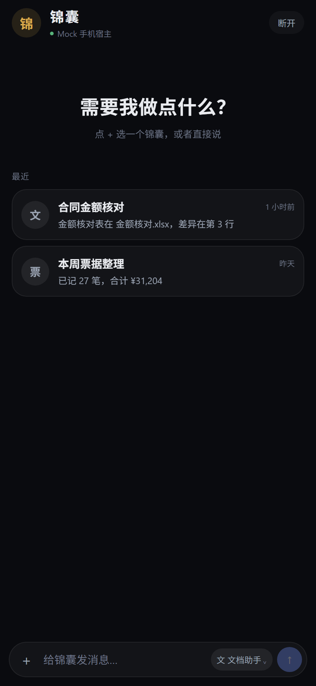
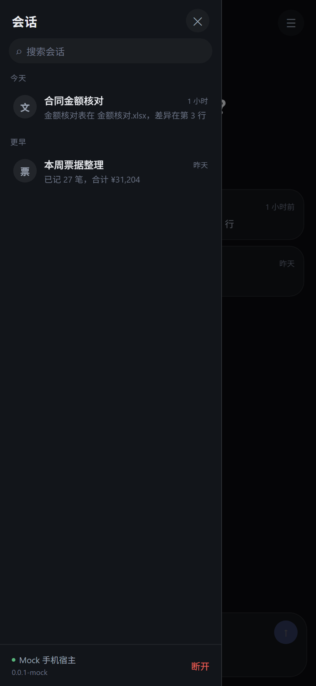
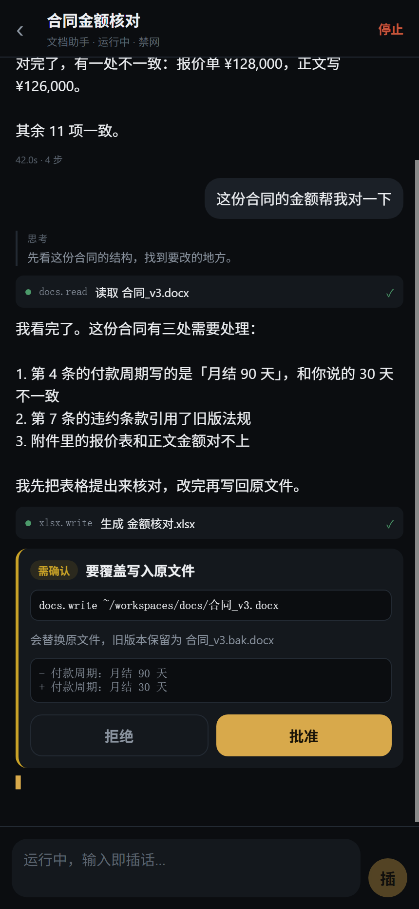

# dsh-palm · 锦囊

> 装进口袋的智能体。有事，交给锦囊。

一个跑在手机上的 DSH 宿主。手机不是遥控器，是一台独立的、能自己干活的机器；电脑是可以互相叫得动的兄弟，不是它的上游。

---

## 三句话

1. **手机是完整宿主。** 引擎、工作区、会话、能力全部在本地，除调模型必须联网，其余离线可用。
2. **能力是契约，不是提示词。** 一个预设 = 一份工具表 + 一套权限 + 一个模型策略。模型看不见没给它的工具。
3. **跨设备只同步"身份与记忆"，不同步"文件与执行"。** 要文件就引用，要算力就委派。

## 现在长这样

<p>



</p>

左：首页就一个输入框 · 中：会话都在抽屉里 · 右：审批卡只看一屏就能决定

## 它不是什么

| 不是 | 为什么 |
|---|---|
| 遥控器 | 遥控器是电脑的从属端，电脑一关机就变砖。本项目的红线是「任何跨设备能力都必须有本地路径」 |
| 纯通知软件 | 通知是壳的一个子系统，不是产品。收到"跑完了"之后必须能就地决策，否则价值只兑现 10% |
| 通用聊天 App | 聊天是电脑擅长的事。手机端优化的是「从收到通知到做完决策隔几次点击」 |
| iOS 本机引擎 | iOS 没有 `fork`/`exec`，这条路物理上不存在 |
| 工作区同步盘 | 所有多端 agent 的坟场。用引用 + 委派替代复制 |

## 文档地图

| 文档 | 内容 | 什么时候看 |
|---|---|---|
| [docs/00-decisions.md](docs/00-decisions.md) | 决策台账：定了什么、为什么、否掉了什么 | 每次想改主意前 |
| [docs/01-product.md](docs/01-product.md) | 定位、场景判断、非目标、命名与词汇 | 对齐"我们到底做什么" |
| [docs/02-architecture.md](docs/02-architecture.md) | 分层、协议边界、单 writer、跨设备与降级 | 动代码结构前 |
| [docs/03-workspaces-presets.md](docs/03-workspaces-presets.md) | 工作区即能力契约、预设三级、会话级裁剪 | 做预设和插件系统时 |
| [docs/04-tech-stack.md](docs/04-tech-stack.md) | RN + Expo prebuild、三条硬规矩、依赖选型 | 开始写第一行代码前 |
| [docs/05-runtime.md](docs/05-runtime.md) | 引擎生命周期、rootfs 分层、尺寸预算 | 做运行时和打包时 |
| [docs/06-roadmap.md](docs/06-roadmap.md) | 四阶段路线、v1 范围、验收标准 | 每周对齐进度 |
| [docs/07-open-questions.md](docs/07-open-questions.md) | 尚未决定的事项 | 卡住的时候 |
| [docs/08-verification.md](docs/08-verification.md) | 一周真机验证清单（Node/体积/内存/后台） | **动手接真机引擎之前** |
| [docs/09-ui.md](docs/09-ui.md) | 界面语言：颜色、形状、排版、固定结构 | 改动任何界面前 |
| [docs/10-dsh-api.md](docs/10-dsh-api.md) | **真 dsh 引擎的接口实测**（RPC / mux 流 / 事件表） | 写适配器前 |
| [docs/11-pairing.md](docs/11-pairing.md) | 配对：手机怎么证明自己是主人 | 动连接逻辑前 |
| [docs/12-model-login.md](docs/12-model-login.md) | 模型登录：绑 Key 已接，账号 OAuth 没有导出端点 | 做登录页前 |
| [docs/13-local-engine.md](docs/13-local-engine.md) | 本机引擎落地清单（阶段 1，未实现） | 上真机前 |
| [docs/17-handoff.md](docs/17-handoff.md) | 交接：真机运行时的现状、踩过的坑、下一步 | 接手真机部分时 |
| [docs/18-run-on-new-machine.md](docs/18-run-on-new-machine.md) | **新电脑怎么跑**：看界面 / 连真 dsh / 打安卓包 | 刚 clone 下来时 |
| [docs/19-ui-research.md](docs/19-ui-research.md) | dsh-go 的 UI 调研、与锦囊的差距、三批施工顺序 | 动界面前 |
| [docs/20-open-work.md](docs/20-open-work.md) | **非 UI 的欠账**：P0/P1/P2 + 工程债 | 排期时 |
| [docs/21-git-workflow.md](docs/21-git-workflow.md) | 分支/提交规范：从 develop 开，一次一个分支 | 每次动代码前 |
| [docs/23-requirements.md](docs/23-requirements.md) | **v1 需求冻结 + 运行时分工 + 插件兼容体系** | 动手前必读 |
| [docs/24-plugin-compat-matrix.md](docs/24-plugin-compat-matrix.md) | dsh 305 个包的手机兼容矩阵（L0–L4） | 判断插件能不能跑 |
| [docs/25-m1-spike-results.md](docs/25-m1-spike-results.md) | **M1 spike 实测**：just-bash 在 Hermes、WebView 官方前端 | 接轻引擎前 |
| [docs/26-light-engine.md](docs/26-light-engine.md) | **轻引擎 MVP + IFileSystem 适配**：真实工作区、shell、agent loop | 动轻引擎 / 工作区适配时 |

## 跑起来

需要 **Node 22.13+**。完整清单（真引擎、打安卓包、大文件下载）见
[docs/18-run-on-new-machine.md](docs/18-run-on-new-machine.md)，下面是三分钟版。

> 国内网络建议先 `npm config set registry https://registry.npmmirror.com`，否则装依赖会很慢。

```bash
git clone -b develop https://cnb.cool/debaox3.0/test-new-technology/dsh-palm
cd dsh-palm
npm install                # 根依赖（引擎 + 测试）
npm --prefix app install   # App 依赖（Expo / RN）

npm run engine             # mock 引擎，:8787
npm --prefix app run web   # 浏览器 http://localhost:8081
```

`npm run engine` 会打印：

```
HTTP   http://localhost:8787/health
WS     ws://localhost:8787/ws
LAN    ws://192.168.x.x:8787/ws   <- 手机里填这个
```

手机上看界面：`npm --prefix app start`（Expo Go 扫码）。

### 验证协议层（不需要手机）

```bash
npm run verify     # typecheck + 11 条端到端用例
```

## 连真引擎

Mock 引擎之后，有一个能连**真 dsh** 的桥：`engine/src/real/`。

```bash
# 真 dsh 启动后会打印 http://127.0.0.1:8899/?token=xxx
node --import tsx engine/src/real/main.ts http://127.0.0.1:8899 <token> 8788
```

App 里把引擎地址填成 `ws://<电脑IP>:8788/ws`，**再填桥打印的六位配对码**，就能看到真宿主上的会话、预设（standard / ptc / minimal / cordis），以及完整对话——真引擎没有"消息列表"，只有事件流，回合是 `engine/src/real/project.ts` 折出来的。

同一份桥也能打成单文件 `dist/dsh-palm-bridge.cjs`，在手机里和 dsh 一起跑（本机模式，见
[docs/17-handoff.md](docs/17-handoff.md)）。

配对怎么设计的、为什么不做账号登录，见 [docs/11-pairing.md](docs/11-pairing.md)。

## 现在已经有的

| 模块 | 位置 | 状态 |
|---|---|---|
| 协议契约 | `app/src/protocol/` | 消息信封、能力协商、事件表、预设与能力契约 |
| 引擎客户端 | `app/src/lib/client.ts` | 请求关联、事件订阅、超时、指数退避重连 |
| Mock 引擎 | `engine/` | 能力协商、流式块、工具调用、审批、预设切换 |
| 真引擎桥 | `engine/src/real/` + `dist/dsh-palm-bridge.cjs` | 连真 dsh：会话 / 模型 / 审批 / 提问 / 流式 / 配对鉴权 |
| 端到端测试 | `test/e2e.test.ts` | 11/11 通过 |
| 轻引擎 | `app/src/engine/light/` | 进程内 agent loop：会话 / 流式 / 审批 / 提问 / 工具，走同一份协议 |
| 文件系统适配 | `app/src/engine/fs/` | `IFileSystem` → Node / expo-file-system，真实工作区 `/workspace` |
| Shell | `app/src/engine/shell/` | just-bash + 手机限额（30s / 24k 输出 / 循环与遍历上限） |
| App 界面 | `app/src/ui/` | 连接页、会话列表、聊天流式、审批卡、提问卡、会话内换预设 |
| Android 宿主 | `app/android/` | 前台服务 + proot + 自带 rootfs/node/dsh，真机跑通 |

## 现在还没有的

- 轻引擎的文档 JS 库（docx / xlsx / pdf）与生图（M1 后半，见 [26](docs/26-light-engine.md)）
- iOS 本机引擎（物理上不可能，没有 fork/exec）和 iOS 遥控器（阶段 2）
- 拍照 / OCR
- 远程推送（跑完/待审批的**本地通知**已接，真机验过）
- 插件市场、桌宠、皮肤
- 详见 [20-open-work](docs/20-open-work.md)

## 当前状态

**阶段 1 完成：手机自带运行时 + 真引擎对话，真机跑通。**

- [x] 产品定位与场景取舍
- [x] 命名
- [x] 架构分层与技术栈
- [x] 运行时与打包策略
- [x] 路线与验收标准
- [x] 阶段 0：协议契约 + mock 引擎 + UI 骨架
- [x] 阶段 1：Android 宿主（proot + rootfs + node + dsh，真机 PLR110 / Android 16 验证）
- [x] 真引擎桥：会话 / 流式 / 审批 / 提问 / 配对
- [x] 本机一键启动：自动配对、自动连接、引擎日志落盘
- [ ] 阶段 2：跨设备（委派、通知、iOS 遥控器）

## 一句话记住我们和别人的区别

别人做的是「在手机上也能用你的 agent」，我们做的是「**手机上有一个属于你的 agent，它还有一台电脑可以叫**」。

---

## 许可

[AGPL-3.0](LICENSE)。

社区项目，与 DeepSeek 官方无关。基于 [DeepSeek Harness](https://github.com/deepseek-ai/deepseek-harness) 构建，"DeepSeek" 名称与标识归其所有者所有。
