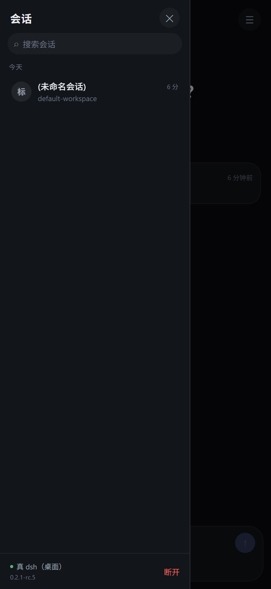

# 10 · 真 dsh 引擎的接口（实测）

> 版本：**0.2.1-rc.5**（`runtime.json` 里的 `desktopVersion`）。这份文档是逆着跑通的，不是抄的。
> ⚠️ DSH 还在预览期，接口会变。任何一条都当成"某次实测的结果"，不是承诺。

## 怎么起一个隔离实例

不要用你正在用的那个 DSH。`DSH_HOME` 指向临时目录，端口另给：

```bat
set ELECTRON_RUN_AS_NODE=1
set DSH_HOME=D:\tmp\dsh-home
"C:\...\DeepSeek Harness.exe" --expose-internals ^
  "C:\...\resources\app.asar\dsh\node_modules\@deepseek-ai\dsh-desktop-host\lib\cli.js" ^
  web --host 127.0.0.1 --port 8899 --no-open
```

启动后 stdout 打印：

```
dsh web: http://127.0.0.1:8899/?token=<43 位>
```

## 一、认证

`GET /?token=<token>` → **303**，带 `Set-Cookie: dsh-auth-<hash>=v1.<base64>`。

```
cookie 名字里的 <hash> 每次启动都不同，不要硬编码。
```

之后所有 `/api/*` 必须带这个 cookie。**把 token 拼在 `/api/...?token=` 上不认**，返回 401。

## 二、HTTP RPC

统一走 `POST /api/<namespace>/<method>`。

请求：

```json
{
  "type": "client-request",
  "rpcId": "<uuid>",
  "method": "session/list",
  "payload": { "args": { } }
}
```

响应：

```json
{
  "type": "server-response",
  "rpcId": "<同一个 uuid>",
  "result": { "ok": true, "value": { } }
}
```

失败时 `result.ok = false`。

### 实测到的方法

| 方法 | args | 返回 |
|---|---|---|
| `session/list` | `{ _request: {} }` | `{ items: SessionListItem[] }` |
| `session/create` | `{ request: { workspaceId, sessionId, agentPreset } }` | `{ sessionId, agentPreset }` |
| `session/projections` | `{ request: { sessionId } }` | 投影对象 |
| `session/modelCatalog` | `{}` | `{ default:{provider,model}, groups, routableProviders, failures }` |
| `agentPresets/list` | `{}` | `{ presets: [{ id, order, isDefault }] }` |
| `permissionPresets/catalog` | `{}` | `{ options, defaultOptions, defaultPreset }` |
| `workspace/initializeDefault` | `{}` | 工作区 |
| `settings/describe` | `{}` | 全量设置 schema（namespace 列表） |
| `credentials/describe` | `{ refs: string[] }` | `{ NAME: { configured, writable } }` |
| `commands/list` | `{ agentId }` | 命令定义数组 |
| `skills/list` | `{ request: { sessionId } }` | `{ skills: [{ name, description, modelInvocable }] }` |
| `dynamicCordisRunner/inventory` | `{}` | `[]` |

### SessionListItem

```json
{
  "sessionId": "session-41d4cd02-…",
  "updatedAt": 1793467524832,
  "agentAvailable": true,
  "formatStatus": "current",
  "running": false,
  "blank": true,
  "cwd": "C:\\Users\\chenf\\Documents\\…",
  "projections": {
    "kind": "sequenced",
    "asOfSeq": 2,
    "values": {
      "title": null,
      "agentPreset": "standard",
      "permissions": { "currentValue": "workspace-write" },
      "sessionStats": { "turns": 0, "steps": 0, "llmMs": 0, "toolMs": 0 },
      "tokenUsage": { "uncachedInputTokens": 0, "outputTokens": 0, … },
      "turnOutline": [],
      "workingDirectory": "…"
    }
  }
}
```

**标题不在会话对象上，在 `projections.values.title` 里**，可能是 `null`（新会话还没生成标题）。

## 三、WebSocket 多路流

`ws://<host>/api/remote.mux`，仍然要带同一个 cookie。

客户端开流：

```json
{ "type": "open", "streamId": "<uuid>", "endpoint": "session/follow", "payload": { "args": { … } } }
```

服务端按 `streamId` 回：

```json
{ "type": "item", "streamId": "<uuid>", "value": { … } }
```

### 实测到的流端点

| endpoint | args | 首帧 |
|---|---|---|
| `session/follow` | `{ request: { address: { kind:'session', sessionId }, assistantStream:true, maxMessages:500 } }` | `{ type:'snapshot', header, cursor, records, hasMore, projections, assistantStream }` |
| `workspace/follow` | `{}` | `{ type:'baseline', value:{ items:[…] } }` |
| `account/watch` | `{}` | `{ status:'signed-out', links:{…} }` |
| `remoteAccess/follow` | `{}` | `{ type:'baseline', owner:true }` |
| `session/control` | `{}` | `{ type:'baseline', value:{ projections:{…} } }` |
| `$events` | `{}` | `{ type:'ready', clientId, host:{home} }` |

### 快照

```json
{
  "type": "snapshot",
  "header": {
    "version": 4,
    "id": "session-41d4cd02-…",
    "createdAt": 1793467524832,
    "cwd": "C:\\Users\\…",
    "agentPreset": "standard"
  },
  "cursor": …,
  "records": [ { "type":"event", "event": { "type":"permission/preset", "seq":0, "time":…, "data":{ "preset":"workspace-write" } } } ],
  "hasMore": false,
  "projections": { … },
  "assistantStream": { "revision": 0 }
}
```

**记录是「事件流」**，不是消息数组：`{type:'event', event:{type, seq, time, data}}`，seq 单调递增。增量应该是同一形状的追加 item。

## 四、和我们的协议对在哪

| 我们的 | 真实的 | 差异 |
|---|---|---|
| `sessions.list` → `SessionSummary[]` | `session/list` → `items[]` | 要拍平 `projections.values`；`title` 可能为 null |
| `sessions.get` → `SessionDetail` | `session/follow` 快照 | 我们是"消息回合"，它是"事件记录"，要跑一遍投影 |
| `sessions.create` | `session/create` | 它是先本地生成 `sessionId` 再提交，我们是服务端生成 |
| `presets` | `agentPresets/list` | **官方原生就有预设**（standard / ptc / minimal / cordis），但没有名字和说明，只是 id |
| 能力契约 | `permissionPresets/catalog` | 官方只有三档权限（read-only / workspace-write / danger-full-access），没有"工具白名单" |
| `approval.requested` | 走 `session/follow` 的事件 | 还没验到具体事件名 |
| `run.delta` 流式 | `assistantStream` | 有 `revision`，说明是增量修订模型 |

### 三个已经能下的结论

1. **预设这个概念是对的** —— 官方自己就有 agent presets，我们只是把它升级成"带能力契约的预设"。
2. **权限模型比我们想的粗** —— 官方三档，我们要的"这个工作区只能用文档工具"需要自己在上层做工具裁剪。
3. **消息不是消息，是事件** —— 我们后端的 `Turn/Block` 模型必须在适配层里由事件流投影出来，不能 1:1 映射。

## 五、事件表（从会话日志读出来的）

抓包卡在"没有凭据发不出消息"，但**日志能直接读**。

位置：`$DSH_HOME/sessions/<workspace 路径转义>/session.v4.jsonl.zstd`

格式：**多个 zstd 帧拼接**，每帧一行 JSON。Node 的 `zstdDecompressSync` 只解第一帧，必须按 magic
（`28 B5 2F FD`）切帧后逐帧解。实测 2.1MB 的文件切成 1549 帧。

一次真实会话（34 条用户消息 / 334 步）的事件分布：

| 次数 | 事件 |
|---|---|
| 352 / 351 | `tool/call` / `tool/result` |
| 334 / 333 | `step/start` / `step/end` |
| 334 | `assistant/message` |
| 335 | `session-log-deepseek/delivery-accepted` |
| 170 / 169 | `job/registered` / `job/settled` |
| 44 | `agent/inbox/spliced` |
| 34 | `user/message` |
| 20 / 19 | `turn/start` / `turn/end` |
| 7 | `workspace/changes` |
| 6 | `deliverables/presented` |
| 3 | `todo/write` |
| 2 | `session/title`、`permission/preset`、`sandbox/mode`、`approval/policy` |

### 关键形状（已脱敏）

```
turn/start    { turn }
turn/end      { turn, reason:{ kind:'completed' } }
step/start    { turn, step }
step/end      { turn, step }

user/message  { content:[{type:'text', text}], role:'user', id,
                source:{ kind:'user' | 'user-approval' } }   surfaceOp:'append'

assistant/message
              { turn, step,
                message:{ role:'assistant', content:[…], id,
                          source:{ kind:'model', provider, model } },
                usage:{ inputTokens, outputTokens, cacheReadTokens, cacheWriteTokens, totalTokens },
                stream:[{ type:'chunk', time, chunk }] }      surfaceOp:'append'

tool/call     { turn, step, callId, name, arguments }
tool/result   { turn, step,
                message:{ role:'tool', toolCallId, content, isError, id },
                error?:{ name, code },
                sourceEventSeqs:[…] }                          surfaceOp:'append'

session/title { title, messageSeqs:[…], source:{ kind } }
model/selection { provider, model, reasoningEffort }
approval/policy { policy:'ask' }
permission/preset { preset:'workspace-write' }
sandbox/mode  { mode }
```

### 三个能直接指导实现的发现

1. **`surfaceOp:'append'`** —— 消息类事件自带"往界面上追加"的语义，说明服务端已经在帮客户端做投影，我们照着 append 就行。
2. **审批不是独立事件** —— 日志里只有 `approval/policy`（策略声明）和 `source:{kind:'user-approval'}` 的用户消息，**没有** `approval/requested`。说明审批请求可能是运行时态（走 mux 流，不落日志），只在被回答时留下痕迹。这一条决定了：**审批必须在线抓，日志补不了。**
3. **`stream` 数组在 assistant/message 里** —— 流式 chunk 是随最终消息一起落盘的，实时增量还得从 mux 流拿。

## 六、还差什么

| 缺口 | 卡在哪 | 靠日志能补吗 |
|---|---|---|
| 消息投影 | 事件形状已拿到 | ✅ 能 |
| 发消息 | 没抓到发送方法 | ❌ 不能 |
| 流式增量 | `assistantStream` 的修订格式 | ❌ 不能（日志里是整体） |
| 审批请求 | 运行时态，不落日志 | ❌ 不能 |
| 工具卡片 | `tool/call` 的 `arguments` 是 JSON 字符串 | ✅ 能 |

**下一步该做的**：在真 UI 里发一条消息、触发一次审批，把 WS 帧全抓下来。这一步做完，适配器就能写了。

## 七、适配器已实现（只读路径）

桥在 `engine/src/real/`，对外说我们的协议，对内调真 dsh。**App 不用改一行代码就能连它。**

```bash
# 先起真 dsh（见开头），拿到带 token 的 URL
node --import tsx engine/src/real/main.ts http://127.0.0.1:8899 <token> 8788
# 然后在 App 里把引擎地址填成 ws://<你的电脑IP>:8788/ws
```



已经打通的：

| 我们的方法 | 映射到 |
|---|---|
| `capabilities.get` | `agentPresets/list` → 4 个宿主预设（standard / ptc / minimal / cordis） |
| `sessions.list` | `session/list` → 摊平 `projections.values` |
| `sessions.get` | `session/follow` 首帧 snapshot → 取 header 里的 `agentPreset` |

**没打通的**：`sessions.send` / `steer` / `stop` / `approvals.*` 明确返回 `unsupported`，界面上会报错，而不是假装成功。

### 为什么没打通发送

隔离实例没有凭据（`credentials/describe` 里 `DEEPSEEK_API_KEY.configured = false`，`modelCatalog.routableProviders = []`），真 UI 的输入框被"请选择模型"挡住，回车发不出去，所以**抓不到发送和流式帧**。

要补这一段，必须有一个配好模型的实例：

1. 用官方账号登录后手动发一条消息，同时抓帧（会动到用户凭据）
2. 在测试环境配一个便宜的 provider，跑一次真实额度

**在拿到真实帧之前，不要猜 `session/send` 长什么样。**

### 消息投影什么时候能做

`snapshot.records` 是事件流（`{type:'event', event:{type, seq, time, data}}`），要投影成我们的 `Turn/Block`，得先知道这几类事件的形状：

- 用户 / 助手消息事件
- 工具调用开始与结束
- 审批请求
- `assistantStream` 的增量修订

这四个都卡在"没有一次真实运行"上。

## 八、可复现的验证脚本

仓库里有两个一次性的探针（不进产品代码）：

```bash
# 抓 UI 发出的所有网络请求
node --import tsx scripts/probe-real-dsh.ts "<带 token 的 url>"

# 抓每个 /api 的请求体和响应体
node --import tsx scripts/probe-real-api.ts "<带 token 的 url>"

# 最小客户端：登录 → RPC → WS 开流拿快照
node --import tsx scripts/probe-real-client.ts http://127.0.0.1:8899 <token>

# 桥的端到端验证：起桥 → 用 EngineClient 读真实会话
node --import tsx scripts/test-real-bridge.ts http://127.0.0.1:8899 <token>

# 只读分析会话日志（多帧 zstd，输出事件类型与脱敏结构）
node --import tsx scripts/analyze-session-log.ts <session.v4.jsonl.zstd>
```
