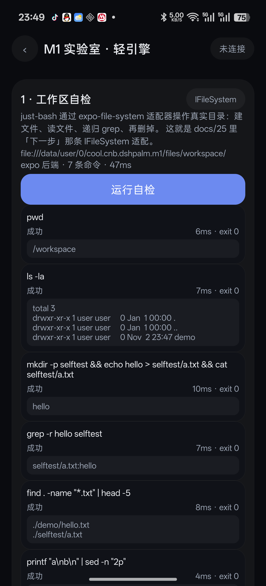
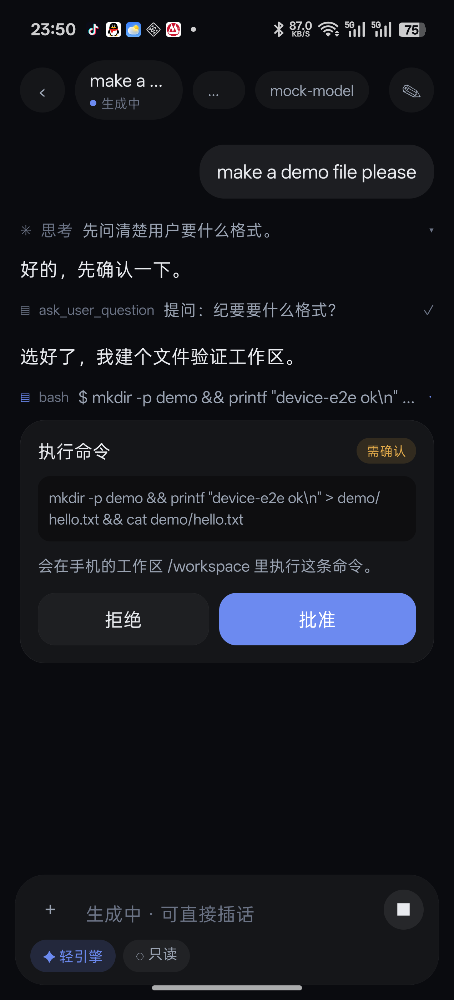
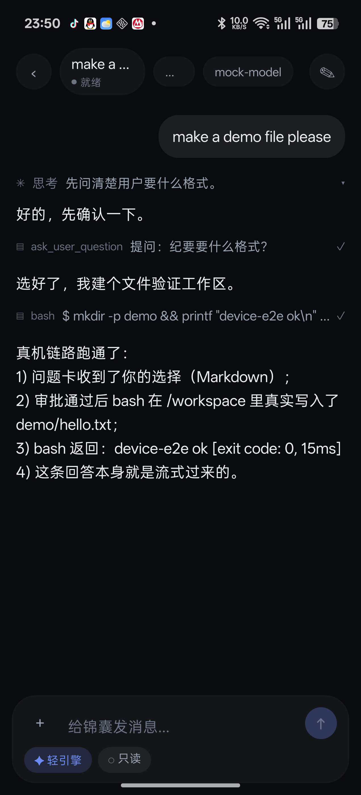
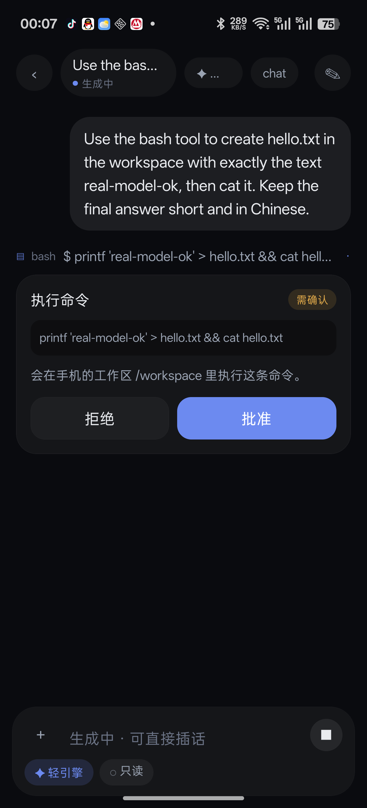
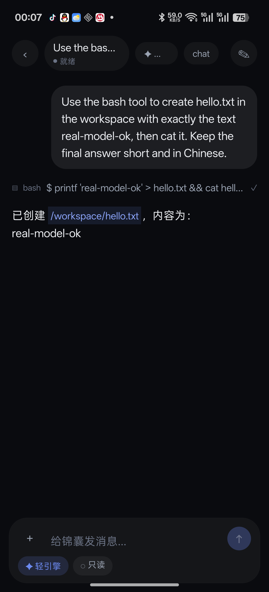
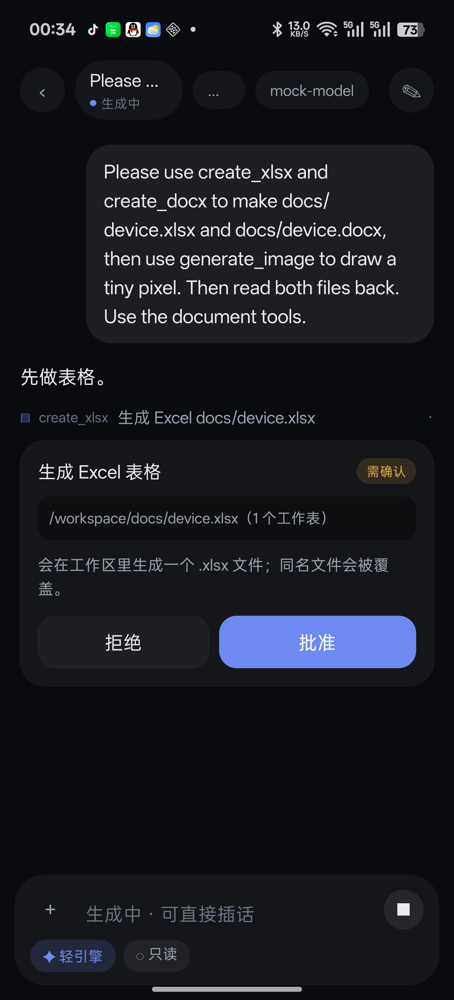
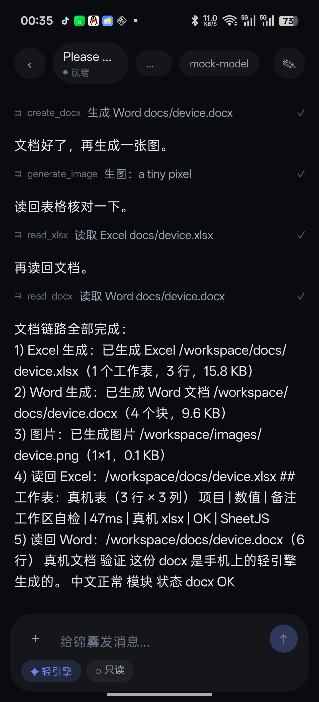

# 26 · 轻引擎 MVP + IFileSystem 适配

> 状态：**已实现并真机验证（PLR110 / Android 16；假模型 + DeepSeek 真模型 +
> docx/xlsx/生图）。**
> 对应 [23-requirements.md](23-requirements.md) §2/§4 与 §8 的 M1 前半，接续
> [25-m1-spike-results.md](25-m1-spike-results.md) 里"剩下的集成工作"第 1 条。
> 验证：`npm run verify`（typecheck + 78 条测试）+ 真机全链路（见 §6）。

## 0. 一句话

**手机不装 proot 也能干活了**：just-bash 通过 IFileSystem 适配器直接读写
`<filesDir>/workspace`，外面套一个进程内的 TS agent loop（会话 / 流式 / 审批 /
提问 / 工具），UI 走的是和真宿主完全一样的协议。

## 1. 为什么是这两件事一起做

docs/25 的结论是：just-bash 在 Hermes 上能跑（毫秒级），但它的 VFS 还是
`InMemoryFs`——**命令跑得再快，文件不在手机上**。所以第一件事是把
`IFileSystem` 落到真实目录。

而只要文件能落盘、bash 能跑，"默认引擎"就只差一层 agent loop：模型调用、
工具回灌、审批、提问。这两件事合在一起才是一个能用的 M1 纵切面；拆开做，
任何一半都无法验证。

## 2. 分层

```
app/src/ui/…                     界面只认 protocol（和连真宿主时同一份）
        │  EngineTransport（app/src/lib/client.ts）
        ├── EngineClient       ── WebSocket → 远程/本机完整引擎
        └── LocalEngineClient  ── 进程内 → LightHost
                                     │
                             LightHost（协议方法 + 事件）
                                     │
                                  Agent（流式 / 工具 / 审批 / 提问）
                                   ├── provider（OpenAI 兼容 SSE）
                                   └── tools（bash / 读写文件 / 文档 / 生图 / 提问）
                                     │
                                  SandboxFs（IFileSystem 实现）
                                   ├── NodeBackend（测试 / 桌面）
                                   └── ExpoBackend（手机）
```

关键点：**store 只依赖 `EngineTransport`**，加轻引擎没有动任何界面组件。
`docs/02-architecture.md` 那条"界面永远只认协议"这次是真的兑现了。

## 3. IFileSystem 适配

### 3.1 结构

| 文件 | 职责 |
|---|---|
| `app/src/engine/fs/path.ts` | chroot 式虚拟路径：`..` 到根停住、不越界 |
| `app/src/engine/fs/errors.ts` | `ENOENT:` 形状的 errno（just-bash 的命令靠消息判断错误） |
| `app/src/engine/fs/backend.ts` | 后端接口：相对路径 → 读写/枚举/删改 |
| `app/src/engine/fs/sandbox.ts` | `SandboxFs implements IFileSystem`：路径、errno、权限位/mtime 覆盖层、读上限、索引 |
| `app/src/engine/fs/nodeBackend.ts` | `node:fs/promises`（测试 / 桌面） |
| `app/src/engine/fs/expoBackend.ts` | 纯逻辑，注入 `ExpoFsApi`（Node 里可测） |
| `app/src/engine/fs/expoFsApi.ts` | 真机的 `expo-file-system` 绑定（`.native` 入口才 import） |
| `app/src/engine/fs/mount.ts` | `MountableFs`：内存根 + `/workspace` 挂真实目录 |

### 3.2 为什么用 MountableFs 而不是直接把工作区交给 Bash

Bash 构造时会往传入的文件系统里铺默认布局（`/bin`、`/usr/bin`、`/dev`、
`/proc` 的占位文件）。直接交真实目录，用户工作区会被塞进几百个假命令文件。

所以根用 `InMemoryFs`（默认布局落内存），真实目录挂到 `/workspace`
（just-bash 官方推荐的用法）。测试里断言了：跑完 `ls /` 之后，
真实工作区里**没有** `bin/`。

### 3.3 语义取舍（写清楚，不假装）

| 能力 | 实现 |
|---|---|
| 路径越界 | 虚拟路径 chroot 式规范化，`../../etc/passwd` 只会变成工作区里的 `/etc/passwd`；工具层另外拒绝越界路径 |
| 软链 / 硬链 | **不支持**，`symlink`/`link` 抛 `EPERM`，`readlink` 抛 `EINVAL`（和 just-bash `ReadWriteFs` 默认策略一致） |
| `chmod` / `utimes` | 手机文件系统没有这些 API：存在内存覆盖层里，`stat`/`ls -l` 能看见，重启后丢（MVP 可接受） |
| 大文件 | 单次读取默认 10MB，超了报 `EFBIG`（避免把 Hermes 堆打爆） |
| `getAllPaths` | 异步 `refreshIndex()` 生成快照；shell 执行前刷新。接口是同步的，所以拿不到就让 glob 退化（just-bash 的 `**` 实际走 `readdirWithFileTypes`，不依赖它） |
| 目录大小 | expo 的语义和 POSIX 不同，统一报 0 |

### 3.4 测试

`test/fs-sandbox.test.ts`（13 条）：路径规范化、文本/二进制、errno、递归
cp/mv、chmod/utimes 覆盖层、只读、EFBIG、`createExclusive`、索引，外加一份
**假 expo** 验证 `ExpoBackend` 的路径映射与 copy/move 解包。真机上的
`expo-file-system` 绑定不在这里跑，靠实验室自检。

## 4. Shell 工具

`app/src/engine/shell/bash.ts`。just-bash 的能力边界照 docs/25，不重复；
这里补的是手机需要的**护栏**：

| 限额 | 值 | 依据 |
|---|---|---|
| 单条命令墙钟 | 30s（工具参数可到 120s） | 10 万行 awk 要 4.6s，手机不该随手跑这种量 |
| 命令数 / 循环数 | 2000 / 5000 | 防 `while true` |
| 输出 | 每条流 24k 字符，头 2/3 + 尾 1/3 | 模型 prompt 装不下 |
| 源码 / heredoc | 256KB | |
| 总输出 / 字符串 | 2MB | Hermes 内存 |
| 遍历 | 5000 条 / 64 层 | |

没有 python / js-exec / 网络：手机端显式关闭（`python:false`、`javascript:false`），
模型不会以为 `python3` 可用。

`test/shell.test.ts`（10 条）覆盖：cwd、真实落盘、grep/find/glob、越界读、
退出码、截断、超时（`sleep 5` + 300ms 限时）、外部 abort、死循环、状态连续。

## 5. 轻引擎

### 5.1 模型调用（`light/provider.ts`）

OpenAI 兼容 `chat/completions` + SSE：

- `content` 增量 → `onText`，`reasoning_content` / `reasoning` → `onThinking`；
- `tool_calls` 按 index 拼装（流式工具调用是分片的）；
- `usage`（`stream_options.include_usage`）；
- 401/403/404/429/5xx → 人话错误；空响应当成错误（Base URL 指错时常见）。

传输层分平台：Node/web 用 `fetch + ReadableStream`；**Android/iOS 用
XMLHttpRequest 的增量 `responseText`**——RN 的 fetch 会把响应体收完再交给 JS，
拿不到流式 body，这是 docs/25 之后才会踩到、但一定会踩到的坑。

`test/provider.test.ts`（4 条）：本地 HTTP 服务按 17 字节乱切 SSE，验证行缓冲、
文本/思考/工具分片/usage、401/404、空响应、URL 拼接。

`test/light-e2e.test.ts`（1 条）：真 HTTP + 真 SSE + 真 `LightHost`，只有模型是
本地假服务——走完"流式回答 → 审批 → bash 落盘 → 工具结果回灌 → 最终回答"，
并断言第二次请求里带了 `role:'tool'`。

### 5.2 Agent loop（`light/agent.ts`）

一次 `sessions.send` = 一次 run：

```
run.started
  → 建 assistant 回合（block.appended）
  → 流式 block.delta（text / thinking）
  → 有 tool_calls 就逐个执行：
       审批卡（workspace-write）→ 批准/拒绝 → 工具结果回灌成 tool 消息
  → 再问模型（最多 8 步）
run.finished(done | stopped | error)
```

- **插话（steer）**：host 先把用户消息写进历史，再 abort 当前这一步的模型调用；
  agent 保留已流出内容、换一个新的 step controller 继续，同一个 run 不结束。
  所以界面不会闪一下"已停止"。
- **停止（stop）**：abort 当前步 + 把挂着的审批/提问一起拒绝，agent 不会卡在 await。
- 历史超过 180k 字符时丢最老的消息（Hermes 内存有限）。

### 5.3 工具（`light/tools.ts`）

| 工具 | 审批 | 说明 |
|---|---|---|
| `bash` | workspace-write 下要 | 走 ShellRunner；风险词（`rm -rf` 等）标高危 |
| `read_file` | 不要 | 带行号，offset/limit，40k 字符截断 |
| `write_file` | 要 | 自动建父目录，2MB 上限 |
| `list_dir` | 不要 | `d`/`f` 前缀，500 项上限 |
| `create_docx` | 要 | blocks 结构化 → .docx（标题/段落/列表/表格/代码/分页） |
| `read_docx` | 不要 | 解 zip 抽 `word/document.xml` 文本，不还原样式 |
| `create_xlsx` | 要 | sheets/rows 二维数组 → .xlsx（多工作表） |
| `read_xlsx` | 不要 | SheetJS 读成文本表格，行/列/字符都有上限 |
| `generate_image` | 要 | 可选生图渠道；没配就明确报错，不假装生成 |
| `ask_user_question` | 不要 | 复用审批卡的 `kind:'question'` 展示位 |

权限三档：

- `read-only`：工具表里**没有** bash / write_file / create_* / generate_image，
  模型硬调用会得到"没有这个工具"；read_docx / read_xlsx 保留；
- `workspace-write`（默认）：写操作与生图逐次审批；
- `danger-full-access`：不逐次审批，但仍只能访问 `/workspace`。

预设两个：`light`（轻引擎）、`reader`（只读）。文档/票据/纪要走 light，
查资料走 reader。

### 5.4 会话与宿主（`light/sessionRepo.ts` / `light/host.ts`）

- 一个会话一个 JSON：`<filesDir>/.dsh-light/sessions/<id>.json`（工作区之外，
  模型看不到）；
- 事件与请求形状完全按 `app/src/protocol`：`capabilities.get`、`sessions.*`、
  `approvals.*`、`questions.answer`、`models.list`、`permissions.list`、
  `presets.list`、`workspaces.list` 等；
- 没实现的方法**显式拒绝**（`unsupported` + 一句 hint），不假装成功：
  账号登录、附件上传、多工作区、provider 增删改。

`test/light-engine.test.ts`（13 条）：capabilities、流式回合、落盘重启、bash
审批通过/拒绝、文档工具审批与落盘、提问回答、只读工具表、停止、插话、
停止时挂起审批、客户端事件、unsupported。

### 5.5 文档与生图

**文档（`app/src/engine/docs/`）**

- `docx` 9.15（内部 fflate）+ SheetJS `xlsx` 0.18.5，都是纯 JS；
- **动态 import**：引擎启动不加载，第一次用文档才付包体成本；
- 生成用 `Packer.toArrayBuffer` / `XLSX.write(type:'array')`，不依赖 Node Buffer；
- 读 docx 不引 mammoth：`fflate` 解压后从 `<w:t>` 抽文本，段落换行、单元格
  用 tab；读 xlsx 直接 SheetJS `sheet_to_json(header:1)`；
- 测试：`test/docs.test.ts` 8 条（docx/xlsx 往返、工具落盘、只读工具表、
  生图 mock）+ `test/light-engine.test.ts` 里的文档工具审批集成；
- 文档工具带来的包体：JS bundle 2.6MB → **4.2MB**（720 → 729 modules），
  APK 仍是一次性安装成本；
- **PDF 还没做**：`pdf-lib` 的标准字体不含 CJK，要内嵌中文字体得先定
  "用哪套子集字体、放 assets 还是按需下载"；这属于产品决策，先不做半成品。

**生图（`light/image.ts`）**

- 渠道配置和文本模型分开（`imageBaseURL / imageModel / imageApiKey / imageSize`），
  官方 DeepSeek 账号没有图像模型；
- 调 `POST {base}/images/generations`，只认 `b64_json`（也兼容 `url` 再下载）；
- 落盘后从 PNG 头读出宽高，工具结果回给模型；
- 没配渠道时 `generate_image` 返回可读错误，引导用户去实验室配置；
- 深链支持可选的 `imageBase / imageModel / imageKey / imageSize`。

**首 token 埋点**

- agent 每跳模型调用后打 `[light] ttft=…ms stream=…ms tools=…`，
  run 结束打 `[light] run <id> <reason>`；
- 原生入口打 `[light] ready=…ms`（建工作区 + 数据目录的实际耗时）；
- 测试不传 `onLog`，不会污染测试输出。

### 5.6 真机入口

`app/src/lib/light.native.ts`：
工作区 = `Paths.document/workspace`，也就是 `<filesDir>/workspace` ——
**和 proot 完整引擎挂进 `/root/work` 的是同一个目录**，两种引擎之间切，
文件是连续的。配置（Base URL / 模型 / Key）存 SecureStore。

另有一条深链，用来扫码/粘贴切换本机模型渠道（生图参数可选）：

```
dshpalm://light?base=https%3A%2F%2Fapi.deepseek.com%2Fv1&model=deepseek-chat&key=sk-…&name=DeepSeek
               &imageBase=https%3A%2F%2Fapi.openai.com%2Fv1&imageModel=gpt-image-1&imageKey=sk-…
               &imageSize=1024x1024
```

冷启动或前台收到后会存好配置并直接连接（`app/src/lib/lightLink.ts`，
单测 `test/light-link.test.ts`）。**Key 在 URL 里，只适合本机扫码/自己粘贴**，
不要发到聊天/群里；用完换一个。

## 6. 怎么验证

### 6.1 Node 侧（不需要手机）

```bash
npm run verify        # typecheck + 78 条测试
```

### 6.2 打包侧（不需要手机，验证 Metro 解析与 `.native.ts` 分叉）

```bash
cd app
npx expo export --platform android --no-bytecode --output-dir .export-js
# Android Bundled … 720 modules；产物里的 node:zlib 已被 metro.config 换成 stub
```

> 本机跑 `expo export`（不关 bytecode）时，Expo 调 hermesc 的临时目录会偶发失败；
> 手动用同一个 hermesc 编译同一个 bundle 是成功的（exit 0）。如果 CI 上复现，
> 再决定是换 `-O` 参数还是升级 expo 的 serializer；这不是本批代码的问题。

### 6.3 真机（2026-11-02，PLR110 / Android 16）

**结果：全链路通过。** 测试包用独立 applicationId（`cool.cnb.dshpalm.m1`）安装，
没有动手机上原有的正式包和数据；验完已卸载。

自动化入口（都在 `scripts/`）：

```bash
# 1. 假模型（真 SSE、不花 Key；按工具结果推进：提问 → bash → 最终回答）
node --import tsx scripts/mock-model-server.ts 8799

# 2. 另一个终端：装包、跑自检、连引擎、发消息、答提问、批 bash、截图
node --import tsx scripts/device-m1-check.ts <apk 路径>
#    底层工具：scripts/device-ui.ts（dump / tap / type / key / swipe / shot / wait）
```

实测数字（logcat `[selfcheck]` / `[light]`）：

| 项 | 结果 |
|---|---|
| 工作区路径 | `file:///data/user/0/cool.cnb.dshpalm.m1/files/workspace/`（expo 后端） |
| 7 条自检命令 | **全部 exit 0，合计 41–47ms**：pwd 5–6ms、ls 6–7ms、mkdir+写+cat 8–10ms、grep -r 6–7ms、find 7–8ms、sed 4ms、rm -rf 3–5ms |
| 跨进程持久化 | 重启 App 后 `ls -la` 能看到上一轮 bash 建的 `demo/` 目录 |
| 轻引擎连接 | `[light] workspace=… files/workspace/ model=mock-model` |
| 三跳请求（提问→bash→收尾） | mock 侧时间戳 15:47:23.7 → 15:47:28.7 → 15:47:33.7（UTC，间隔约 5s，含审批与自动化点击） |
| bash 工具耗时 | 工具返回 `exit code: 0, 15ms`，**包含** Bash 构造成本 → 构造不是问题 |
| 最终回答 | 流式文本里带 `bash 返回：device-e2e ok [exit code: 0, 15ms]`，证明写的是真实文件 |

证据截图：

| 工作区自检 | 审批卡 | 全链路完成 |
|---|---|---|
|  |  |  |

构建注意（本机踩到的坑）：仓库在
`C:\Users\…\Documents\deepseek-harness\default-workspace\dsh-palm`，路径太长，
CMake/ninja 会在 `node_modules/expo-modules-core/android/.cxx` 里报
`build.ninja still dirty` / `mkdir ... No such file or directory`。
把工作区 robocopy 到短路径（这次用 `C:\dp`）再 `gradlew :app:assembleRelease`
即可；`debug.keystore` 不在仓库里（`.gitignore` 忽略 `*.keystore`），需要
`keytool` 生成一次。真机跑完要记得把临时的 `applicationId` 和
`usesCleartextTraffic` 改回去。

#### 真模型（DeepSeek `deepseek-chat`）

假模型只能证明"管线通"，不能证明"模型真的会挑工具"。所以又用真模型跑了一遍
（`scripts/device-real-check.ts`，Key 只从环境变量读，不落盘）：

```powershell
$env:LIGHT_BASE="https://api.deepseek.com/v1"
$env:LIGHT_MODEL="deepseek-chat"
$env:LIGHT_KEY="sk-…"   # 一次性测试 Key
node --import tsx scripts/device-real-check.ts <apk>
```

流程：`am start` 带 `dshpalm://light?...` 冷启动 → App 直接连上 →
发一条英文指令（"用 bash 建 hello.txt，内容 real-model-ok，再 cat 出来"）→
模型自己调 `bash` → 审批 → 流式回答。

| 项 | 结果 |
|---|---|
| 深链冷启动到首页 | 17.4s（含安装；`am start` 后直接连上，`[light] model=deepseek-chat`） |
| 发指令到审批卡 | 21.9s（含 adb 输入 + 输入法切换的自动化开销） |
| 批准到回答结束 | 9.6s |
| 模型选的命令 | `printf 'real-model-ok' > hello.txt && cat hello.txt` |
| 回答 | 「已创建 `/workspace/hello.txt`，内容为：`real-model-ok`」 |

| 真模型审批 | 真模型回答 |
|---|---|
|  |  |

一次性 Key 验完即废，没有写进仓库、日志或截图。

#### 文档 / 生图（Hermes 真机）

同一套自动化换成 docs 模式（`MOCK_PLAN=docs` 的假模型 + 假生图接口，
生图渠道走深链的 `imageBase/imageModel/imageKey`）：

1. 模型依次要求 `create_xlsx`、`create_docx`、`generate_image` —— 三次审批；
2. 再依次 `read_xlsx`、`read_docx` 把文件读回来核对（读操作不审批）；
3. 最后流式汇总。

| 项 | 结果 |
|---|---|
| `[light] ready` | **4ms**（建工作区 + 数据目录，含 expo 绑定） |
| ttft（四次模型调用） | 49 / 62 / 69 / 61 ms（本地假模型） |
| 最后一次流式 | stream **4310ms**（逐帧到达，证明 Hermes 上的 XHR 增量可用） |
| Excel | `/workspace/docs/device.xlsx`，1 个工作表 3 行，**15.8 KB** |
| Word | `/workspace/docs/device.docx`，4 个块，**9.6 KB** |
| 图片 | `/workspace/images/device.png`，1×1，**0.1 KB**（PNG 头解析出宽高） |
| 读回 Excel | 「真机表（3 行 × 3 列） 项目 \| 数值 \| 备注 …」 |
| 读回 Word | 「（6 行）真机文档 验证 这份 docx 是手机上的轻引擎生成的。中文正常 模块 状态 docx OK」 |

| Excel 审批 | 生成 + 读回结果 |
|---|---|
|  |  |

这一步验证的是 **docx / SheetJS / fflate 在 Hermes 里真的能跑**，而且中文没有
乱码、生成的 zip 能被自己读回。PDF 仍未做（见 §5.5 的字体决策）。

## 7. 与 docs/23 · M1 的差距

M1 的验收是「LightEngine MVP：会话/流式/审批/提问 + 文档 JS 库 + 生图」。
除了 PDF，其余都已落地：

| M1 项 | 状态 |
|---|---|
| 会话 / 流式 / 审批 / 提问 | ✅ |
| 真实工作区（IFileSystem）+ shell | ✅（docs/25 的第 1 条） |
| 文档 JS 库（docx / xlsx） | ✅ 生成 + 读回，真机验证 |
| PDF（pdf-lib / pdf.js） | ⬜ 卡在中文字体：标准字体不含 CJK，要定子集字体方案（见 §5.5） |
| 生图 | ✅ 可选渠道（`images/generations`），真机用假渠道验证；真渠道等用户配 Key |
| 命令覆盖与执行限额 | ✅ 限额；命令覆盖按 just-bash 内置表 |
| WebView 与会话态联动 | ⬜ 目前是独立打开（docs/25 第 3 条） |

## 8. 已知风险 / 下一步

1. **XHR 增量在 RN 上**：假模型和真模型都验证过。**ttft 已埋点**：真机
   `[light] ttft=…` 在本地假模型上是 35–69ms；真模型那轮只看了总耗时（9.6s），
   下一批接真模型时把 ttft 也记下来。和 docs/23 §10 的"轻引擎就绪 < 300ms"
   分开看——就绪实测 4ms（expo 绑定 + 建目录）。
2. **expo `new File(root, ...segments)` 的路径编码**：文件名带空格/中文要靠它；
   真机文档验证用的是中文内容、ASCII 文件名，中文文件名还没覆盖，下一批补。
3. **没有 OS 级沙箱**：bash 只能在 JS 层做路径约束 + 限额。`/workspace` 之外
   的宿主文件系统本来也读不到（Hermes 没有 `node:fs`），但不要把这当成安全边界
   写进对用户的承诺。
4. **Bash 构造成本**：每次 `bash` 调用新建一个解释器（避免两个会话共享
   env/cwd 状态）。真机上 bash 工具整条命令 15ms（含构造），可以接受。
5. **多会话并发**：目前一个会话一个 run，没有队列；M2 的调度器再统一。
6. **文档能力的边界**：docx 只做"生成 + 抽文本"，不还原图片/复杂样式；
   xlsx 只做值，不写公式/样式/图表。够"票据、纪要、清单"这三类场景，
   不是 Office 替代品。
7. **PDF 的中文字体**：`pdf-lib` 标准字体不含 CJK。要么内嵌 Noto Sans SC 子集
   （按常用字裁到 1–2MB，放 assets 或首次下载），要么等 full engine 的
   LibreOffice 路径。这是产品决策，先留空。
8. **包体**：文档库让 JS bundle 从 2.6MB 涨到 4.2MB（APK 13MB → 14.7MB）。
   动态 import 只能推迟执行，Metro 默认不拆包；真要降，得按会话能力做按需
   下载 bundle（M2 的插件/资源管道一起做）。
